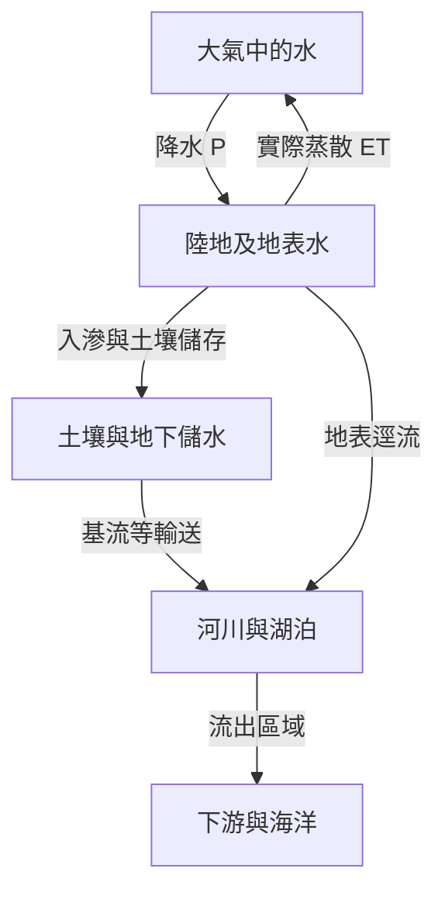
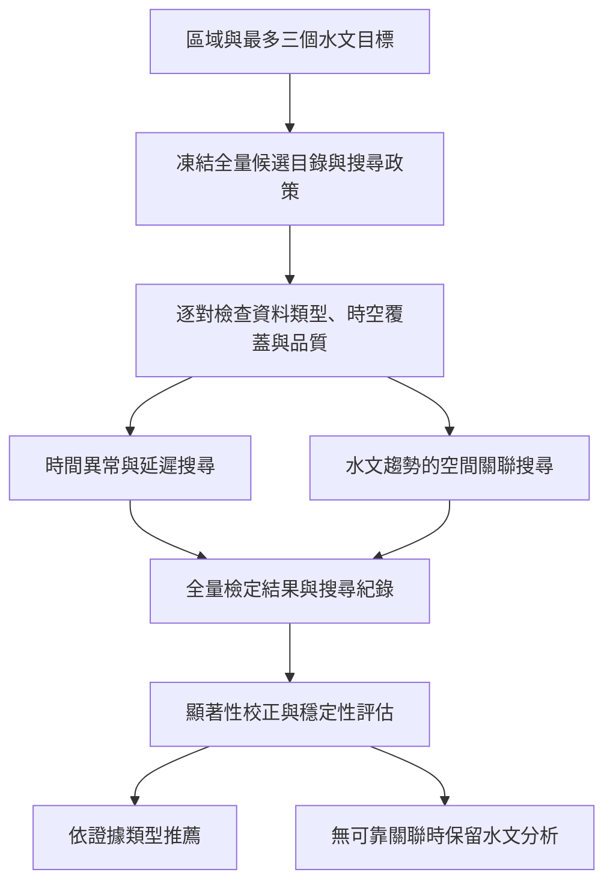
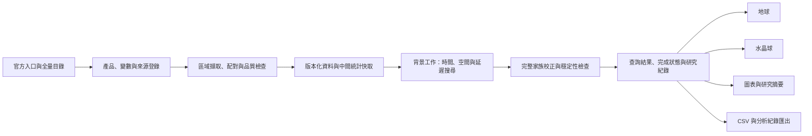

# Aqua Trend：以水循環為核心的 NASA 跨資料關聯探索

> NASA Space Apps Challenge 2026 專案需求與實作規格，更新日期：2026-11-14（Asia/Taipei）。
> 核心需求已經團隊討論確認。本文區分已確認需求、現有資料資產與待驗證項目；不代表全量資料搜尋或研究引擎已完成。區域目錄、七組幾何圖層及一批 GLDAS 格點資料已入庫，點擊選區與研究分析仍待接入及驗證。

## 1. 專案要做什麼

Aqua Trend 幫助研究者以水循環指標為統計目標，從 NASA 地球科學資料中找出值得深入研究的關聯。使用者在可愛的地球上選區域，一輪選擇最多三個水文目標；系統將它們與本題 Resources 可取得的所有符合條件的 NASA 科學變數比較，推薦有統計證據的時間或空間關聯。

候選不限水文資料，也包含溫度、輻射、植被、雲、氣膠、地形、土地覆蓋等。系統自動選擇適用方法、處理資料對齊、季節性、長期趨勢、延遲與顯著性校正。使用者不需挑檢定或調整分析參數。

區域水晶球同步呈現水循環各環節：降水形成往下的雨滴、蒸散形成往上的水氣、土壤水改變土層含水表現。推薦關聯也可進入視覺編碼，例如蒸散量控制粒子數量，所選溫度資料控制粒子顏色；下方同步顯示曲線、地圖及統計證據。

研究者應能快速回答：

- 哪個區域的哪一種水文指標正在改變？
- 變化是季節循環、短期異常，還是觀測期間內的長期趨勢？
- 變化速率是多少？在採用的方法與假設下，證據有多明確？
- 哪些其他 NASA 變數與這項水文變化有關？這是時間連動、延遲反應，還是不同位置的趨勢關係？
- 哪個指標先變、另一個隔多久跟著變？這個順序在資料支持的尺度上是否穩定？
- 這項指標代表水的儲存、輸送通量，還是間接線索？
- 結論來自哪些 NASA 資料，如何重現？

### 已確認的團隊方向

| 項目 | 決定 |
| --- | --- |
| 主要使用者 | 研究者 |
| 核心任務 | 自動推薦可查證的研究線索，支援後續研究 |
| 核心操作 | 先選區域，再選一組最多三個水文目標；系統可先推薦目標組合，使用者可替換或減少 |
| 搜尋廣度 | 本題 Resources 可取得的 NASA 地球科學資料全部進候選目錄，所有符合條件的科學變數都參與搜尋 |
| 分析方法 | 由系統依資料條件決定，不要求使用者挑統計方法或設定參數 |
| 時間關聯 | 優先找去除季節與長期趨勢後的異常連動，包含自動決定範圍的延遲搜尋 |
| 空間關聯 | 以水文變化的空間差異為主，找變化速率與其他變數的關係；狀態差異作背景對照 |
| 推薦條件 | 任一類關係有可靠證據即可推薦，逐項標示證據類型、顯著性與穩定性 |
| 分析期間 | 每對變數使用各自的共同期間，公開實際期間、有效樣本數與解析度 |
| 視覺主體 | 可愛地球與區域水晶球 |
| 水移動的表達 | 結合降水、蒸散、儲水等指標，呈現水循環不同環節的變化 |
| 執行方式 | Demo／常用區域預先分析；其他區域背景執行，顯示日期、進度與暫定／完成狀態 |
| 完成條件 | 全量搜尋及顯著性校正完成後，才發布最終推薦 |
| 無可靠關聯 | 保留水晶球與趨勢，顯示「目前未找到可靠關聯」，不補成推薦 |
| 區域切分 | 已有流域、H3 網格、命名研究區、海域與冰蓋等多層區域；乾旱地區不能因沒有常年河流而被排除 |

「最多三個」限制的是水文目標，沒有把候選資料庫限成三個變數。Demo 區域由團隊自行選擇，系統不以全球熱點推薦作為必要入口。

## 2. 與官方題目的對應

參賽題目為 [Be An Earth System Trend Detective!](https://www.spaceappschallenge.org/2026/challenges/earth-system-trend-detective/)。官方要求涵蓋變數選擇、區域資料取得、足夠長的時間序列、變化速率及顯著性分析；也提醒季節循環可能遮蔽趨勢，線性趨勢已是合適起點。以下是團隊的功能對應，並非官方另訂的功能清單。

| 官方要回答的問題 | Aqua Trend 的功能 |
| --- | --- |
| 什麼正在改變？ | 水文變數目錄、定義及資料類型 |
| 哪裡正在改變？ | 地球選區、區域邊界與區域比較 |
| 如何隨時間改變？ | 同步的水晶球播放與時間序列 |
| 改變多少？ | 原單位數值、每十年的變化速率 |
| 是否顯著？ | 信賴區間、方法假設、資料品質與證據狀態 |

在完成官方趨勢分析要求的基礎上，本專案增加跨資料關聯探索。每個水文目標的趨勢及顯著性，與它和其他變數的關聯及顯著性，必須分開報告；一者顯著不能代替另一者的檢定。

系統的研究價值是減少找資料、整理單位、選分析流程及解讀結果的操作負擔。可愛視覺讓區域水循環容易理解；可重現的分析與資料紀錄支撐研究用途。

## 3. 水移動的科學敘事

地球上的水在研究所關心的一般時間尺度下可近似視為持續循環的總量，但它在海洋、陸地、大氣、冰雪及地下的分布會改變。區域是否有水可用，取決於水存在哪裡、什麼時候抵達，以及輸入與輸出的速度。參考 [NASA 水循環說明](https://science.nasa.gov/earth/earth-observatory/the-water-cycle/)。

### 先區分存量與通量

| 類型 | 意義 | 例子 | 視覺語言 |
| --- | --- | --- | --- |
| 存量／狀態 | 某時間或某期間平均，有多少水或多濕 | 土壤水量、總儲水異常、大氣柱水汽量 | 土層含水、正負異常刻度、水氣濃度 |
| 通量 | 每單位時間有多少水通過某個環節 | 降水率、蒸散率、逕流率、河川流量 | 有方向且有單位的輸送箭頭與粒子 |
| 間接指標 | 反映水文狀態，但本身不等於水量 | 積雪覆蓋率、水面面積、水面高度 | 地景覆蓋、面積及高度標記 |

例如蒸散增加，表示地表往大氣的水輸送通量增加；大氣中實際儲存多少水，還取決於降水及水平輸送。實際蒸散也包含植物蒸騰，不能全部標成湖泊蒸發。潛在蒸散代表條件下的蒸散需求，不能當成實際已移動的水。

區域水量收支可作概念框架：

```math
\Delta S = P - ET + Q_{in} - Q_{out} + H_{in} - H_{out}
```

這裡各項都換算成相同區域、相同期間的水深或體積：`S` 是區域儲水，`P` 是降水，`ET` 是實際蒸散，`Q` 是跨區域邊界的天然側向輸送，`H` 是另行計入且未包含於 Q 的人為調水。模型產生的地表逕流不必然等於流域出口流量。

第一版不宣稱所有項目都已觀測，也不強迫不同產品拼成封閉收支。只有接入對應資料、確認邊界與定義後，才計算收支殘差；殘差也包含資料誤差，不能直接當成地下水變化。



上圖是機制示意。單一衛星指標通常無法追蹤一滴水的完整路徑；水晶球中的路徑必須標明是概念示意、模型推估，或有資料支持的量化輸送。

## 4. 使用流程與最少操作介面


1. 在地球點選研究區域，看到實際邊界、資料可用性與區域特徵；亦提供文字搜尋／清單入口。
2. 選擇一至三個水文目標，例如降水、蒸散、土壤水。每項都有定義、單位及觀測／模型標示。
3. 系統載入版本相符的預先分析結果，或啟動背景搜尋。畫面顯示資料日期、已處理候選數與目前階段。
4. 搜尋期間可查看水晶球、原始曲線及暫定分析；全量搜尋和校正完成後，發布最終推薦。
5. 點選一條推薦，查看成立的關係、方向、強度、延遲、顯著性與穩定性。水晶球、下方圖表和地圖同步呈現對應資料。
6. 比較原始資料、季節型態、長期趨勢及調整後的關係，閱讀系統對季節性影響的說明。
7. 查閱或匯出來源、方法與完整搜尋紀錄；沒有可靠關聯時仍可研究水文本身的變化。

主畫面保留區域、水文目標、推薦選取、歷史播放與證據查閱操作。分析期間、檢定、季節處理、延遲範圍、顯著水準與空間解析度都由系統政策決定，放在唯讀分析紀錄中。不同推薦可有不同共同期間；歷史播放切換推薦時必須顯示實際期間，重疊部分才同步比較。

系統自動化的是分析決策。研究者仍能查看所有處理步驟與參數，並重現同一結果。

## 5. 官方 Resources 的完整盤點

以下 13 項已於 2026-11-14 直接核對 [官方 Resources](https://www.spaceappschallenge.org/2026/challenges/earth-system-trend-detective/?tab=resources)。它們包含工具、資料入口、文章與任務說明，不等於 13 份必須全部接入的水文資料集。

### 官方 NASA DATA & RESOURCES 區塊

| 資源 | 內容與本專案用途 | 建議處理 |
| --- | --- | --- |
| [Giovanni](https://giovanni.gsfc.nasa.gov/) | 跨領域地球科學變數、區域時間序列與地圖 | 盤點可取得的 NASA 科學變數，建立搜尋與對照入口 |
| [Hydrology Time Series](https://disc.gsfc.nasa.gov/information/tools?title=Hydrology%20Time%20Series) | 水文模型時間序列入口 | 盤點產品與變數，與其他入口的相同產品去重 |
| [AppEEARS](https://appeears.earthdatacloud.nasa.gov/) | 多種地理資料的區域／點位擷取、時間序列與品質資料 | 盤點產品及科學欄位，納入可做時間、空間或分組分析的 NASA 資料 |
| [Climate Data Online](https://www.ncei.noaa.gov/cdo-web/) | NOAA 歷史氣候及測站資料，含地圖工具 | 作地面觀測比較候選；機構必須標 NOAA |
| [SeaWiFS 沿岸葉綠素時間序列研究](https://ntrs.nasa.gov/api/citations/20090042747/downloads/20090042747.pdf) | 時間序列與顯著性分析案例 | 作方法閱讀；葉綠素不直接代表水量或水流 |

NOAA CDO 雖被放在這個官方區塊，仍不是 NASA 資料。專案的 NASA 使用證據應具體指向實際採用的 NASA 產品及工具。

### 官方 SPACE AGENCY PARTNER RESOURCES 區塊

| 資源 | 與本專案的關係 | 建議處理 |
| --- | --- | --- |
| [KNMI Climate Explorer](https://climexp.knmi.nl/) | 氣候資料及分析工具 | 可作比較與查核，依各來源規範使用 |
| [Statistical test methods to detect trends in time series data](https://medium.com/@snp.kriss/statistical-test-methods-to-detect-trends-in-time-series-data-b361a0ec530b) | 趨勢檢定介紹文章 | 參考閱讀，實作須回到方法與軟體的正式文件 |
| [A Comprehensive Guide to Statistical Significance](https://www.statsig.com/perspectives/a-comprehensive-guide-to-statistical-significance) | 顯著性概念介紹 | 參考閱讀，不充當水文資料 |
| [CSA RADARSAT Constellation Mission 資料](https://donnees-data.asc-csa.gc.ca/en/dataset/rcm) | 雷達觀測，可研究水面、濕地等變化 | 進階擴充，先核對取得條件及前處理成本 |
| [GEO.ca](https://geo.ca/) | 加拿大開放地理資料入口 | 若選加拿大案例再找具體資料集 |
| [CSA SWOT 任務說明](https://www.asc-csa.gc.ca/eng/satellites/swot/) | 湖泊、河川、水庫與海洋水面變化的任務介紹 | 作地表水擴充入口；任務說明頁本身不是下載後的資料 |
| [Monitoring and protecting our ecosystem from space](https://www.asc-csa.gc.ca/eng/satellites/everyday-lives/monitoring-and-protecting-our-ecosystems-from-space.asp) | 衛星監測生態系與自然資源的應用背景 | 視敘事需要引用 |
| [Synthetic Aperture Radar python Tutorial](https://github.com/asc-csa/Synthetic_Aperture_Radar_Tutorial) | Python／QGIS 雷達影像教學 | 只有實作 SAR 模組時才列為已使用 |

官方 [Judging & Awards Guide](https://www.spaceappschallenge.org/resources/judging-awards-guide/#judging-criteria)強調資料對解題的實質貢獻與整合深度。團隊另外確立了全量資料搜尋的產品要求：以可查證的搜尋紀錄證明廣度與用途。上述十三個連結的盤點不等於底層資料集已全數使用，也不能把工具或文章計為獨立資料集。

### 全量候選庫的範圍與計帳

候選全集以指定 Resources 資料入口可取得的 NASA 地球科學產品／變數為界，保存目錄快照日期、入口與產品識別。非 NASA 與合作機構資料分開標示機構及用途。產品識別可透過 [CMR Search API](https://cmr.earthdata.nasa.gov/search/site/docs/search/api.html)補足，但不因此擴成整個 NASA CMR 的無界搜尋。

以下是全量搜尋的必要規則：

- 所有資料集進入盤點；所有符合適用條件的科學變數進入分析，不設只包含水文或幾個熟悉產品的白名單。
- 依物理意義分流：連續時間量可做時間關聯，靜態高程可做空間關聯，土地覆蓋等分類量做適當分組比較。QA、時間及座標欄位參與品質檢查與對齊，不作一般候選解釋量。
- 同一資料經不同入口取得需合併識別；保留產品、版本、DOI、欄位與入口映射。版本／重複欄位依公開政策處理，不能當作多份獨立證據或用較顯著版本取代不顯著版本。
- 「不適用」必須有資料或方法依據，例如沒有共同期間、無有效變異、解析度不足。尚未完成接入、讀取失敗或尚未實作方法，屬工程缺口，不能冒充科學排除理由。
- 各資料集都要有用途或處理結論，包括有效分析、品質輔助、重複映射與不適用原因。技術缺口未解決時，不能宣稱已完成全量搜尋。

| 覆蓋紀錄 | 需保留的內容 |
| --- | --- |
| 已發現 | 入口、快照日期、資料集與科學變數清單 |
| 已識別／去重 | 同源入口、版本、重複與衍生關係 |
| 已取得 | 實際資料版本、日期、檔案或請求識別 |
| 符合條件 | 對每個水文目標、分析類型與區域適用的配對 |
| 已分析 | 實際期間、樣本、方法、效應與未校正檢定結果 |
| 已校正 | 搜尋家族、校正結果、穩定性與推薦判定 |
| 未顯著／不適用 | 保留結果或具體原因，不從報表消失 |
| 失敗／待處理 | 工程缺口、重試狀態及對完成度的影響 |

[AppEEARS API](https://appeears.earthdatacloud.nasa.gov/api/)提供產品與欄位資訊，可協助建立登錄；[Giovanni 使用指南](https://giovanni.gsfc.nasa.gov/giovanni/doc/UsersManualworkingdocument.docx.html)可作時空配對與重採樣的實作參考。入口列舉、服務限制及實際下載仍需驗證，目前沒有可報告的全量資料集總數。

## 6. 水文目標、跨領域候選與視覺化目錄

水文目標目錄涵蓋水循環主要環節，每輪最多選三項；候選解釋變數則跨全部合格領域。下面列出水文資料及視覺通道示例，不是完整清單，也不構成候選搜尋上限。每個產品接入前須核對定義、版本、品質、範圍及引用。

| 水循環環節／變數 | 資料候選與來源 | 水晶球表達 | 研究界線 |
| --- | --- | --- | --- |
| 降水 | GPM IMERG；題目背景亦點名 GPM | 從大氣落下的雨滴與輸入通量 | 降水估計不是河川流量 |
| 實際蒸散 | GLDAS Noah、MODIS MOD16、MERRA-2 | 往上的水氣粒子與輸出通量 | 包含蒸發與植物蒸騰；不同產品不直接拼接 |
| 潛在蒸散／蒸散需求 | MOD16 PET；GLDAS 適用欄位 | 與實際通量分開的需求指示環 | 不是已經流走的水；GLDAS PotEvap_tavg 為 W/m²，須依定義換算 |
| 土壤水 | GLDAS 分層土壤水、SMAP | 土層含水色階或水量刻度 | 深度與單位必須標出；表層不等於地下水 |
| 地表逕流／地下逕流 | GLDAS 分量 | 地表到河道的箭頭、模型產流數值 | 產流量不直接等於出口河川流量 |
| 陸地總儲水異常 | GRACE／GRACE-FO | 有零基準線的正負儲水異常槽 | 大尺度總量異常，不是絕對水位或單獨地下水 |
| 大氣柱水汽量 | MERRA-2；AIRS 適用產品 | 球內上半部的水汽濃度及柱水量刻度 | 水汽多不代表必然下雨，亦不能直接定位來源 |
| 水汽水平輸送 | MERRA-2 垂直積分東西向／南北向水汽通量 | 大氣層中的方向及通量向量，連接區域邊界 | 必須使用真正的向量欄位；單看水汽多寡不能推導流向或來源 |
| 積雪水當量／融雪 | GLDAS 相應變數 | 積雪儲水與融雪輸送，分開標量 | 積雪覆蓋率、厚度、水當量不可互換 |
| 積雪覆蓋率 | MODIS 積雪產品 | 山地或地表白色覆蓋範圍 | 面積比例不是積雪儲水體積 |
| 湖泊／水庫水面高度及面積 | SWOT 湖泊產品 | 水體輪廓、高度變化與觀測日期 | 水位或面積變化不能未經幾何模型換成體積；使用產品儲水變化欄位仍須核對假設 |
| 河川高程、寬度及流量估計 | SWOT 河道產品 | 河道剖面及資料支持的流量動畫 | 依產品區分觀測與推估；短紀錄不直接支持數十年趨勢 |
| 地表水分布、濕地淹水範圍 | OPERA DSWx、MOD44W；RCM | 地景中的水面與淹水遮罩 | 雲、分類誤差與重訪頻率影響可觀測性；年度遮罩不能冒充逐月變化 |
| 植被與水分壓力 | MODIS 植被等適用產品 | 植被狀態的輔助標記 | 屬間接線索，不把植被指數當水量 |
| 海洋相關變化 | SWOT／其他海面高度、鹽度等適用產品 | 海洋水面或鹽度分布的獨立圖層 | 海平面也受熱膨脹等因素影響，不能全解讀為陸地失水 |

GPM、MODIS、AIRS、MERRA-2、GLDAS 是題目背景點名的任務／模型。GRACE、SMAP 等是團隊可評估的補充來源，不能說成官方 Resources 逐項列出的資料集。任務與具體產品也要分開記錄。

資料定義與限制可先依 [GPM IMERG](https://gpm.nasa.gov/data/imerg)、[GLDAS 變數表](https://ldas.gsfc.nasa.gov/gldas/model-output)、[JPL GRACE mascon 文件](https://grace.jpl.nasa.gov/data/get-data/jpl_global_mascons/)及 [SMAP 任務說明](https://smap.jpl.nasa.gov/mission/description/)查核。GRACE 的發布網格不等於有效辨識尺度，選區過小時系統應停止提供地方尺度解讀。

其他資料示例的官方入口與接入要點：

- [MERRA-2 檔案規格](https://gmao.gsfc.nasa.gov/media/publications/zbly36ziNFDFbmYmvhQeVqPhUo/Bosilovich785.pdf)：`TQV` 是大氣柱水汽量（kg/m²），`EVAP` 是表面蒸發通量（kg/m²/s），`UFLXQV`／`VFLXQV` 是水平水汽輸送（kg/m/s）。存量、垂直交換與水平輸送可各自驅動不同視覺；再分析亦有模型及同化相關限制。
- [MOD16 官方說明](https://modis-land.gsfc.nasa.gov/ET.html)：區分實際 ET 與 PET，標示為結合 MODIS、氣象等輸入的演算法估計。不能稱為衛星直接看到蒸發中的水。
- [MODIS 雪產品](https://modis-snow-ice.gsfc.nasa.gov/)：以雪覆蓋呈現面積；GLDAS 的 SWE_inst 與 Qsm_acc 則分別呈現雪儲水與融雪通量。
- [SWOT 湖泊資料](https://data.nasa.gov/dataset/swot-level-2-lake-single-pass-vector-data-product-version-2-0)與 [NASA SWOT 河道服務](https://gis.earthdata.nasa.gov/portal/rest/services/C3233944997_POCLOUD/SWOT_L2_HR_RiverSP_reach_vD_BASIC/FeatureServer)：核對高程、面積、寬度及流量估計欄位的品質與有效期間。
- [OPERA 產品目錄](https://www.jpl.nasa.gov/go/opera/products/)與 [DSWx 說明](https://science.data.nasa.gov/disasters/data-gallery/opera-dswx)：水面分布的候選。不同光學／雷達產品與發布版本需分開登錄。
- [AIRS 大氣柱水汽趨勢互動地球](https://airs.jpl.nasa.gov/resources/247/total-column-water-vapor-trend-interactive-globes/)：可作視覺參考；該展示未提供顯著性，不能拿其色彩當作本系統檢定結果的驗證。

GLDAS 月產品的 Qs_acc、Qsb_acc、Qsm_acc 等欄位需特別留意：依產品文件，它們是三小時累積量的月平均，不是月總量。換成月總量時需依相應時間窗積分，不能只看 `_acc` 就直接把數字當作 mm/月。

### 欄位與單位接入示例（不限制全量搜尋）

| 項目 | 降水 | 蒸散／土壤水 |
| --- | --- | --- |
| 產品 | GPM_3IMERGM V07，Final 月產品，記錄實際修訂版 | GLDAS_NOAH025_M 2.1 |
| 格點 | 0.1° 發布網格 | 0.25° 發布網格 |
| 欄位 | precipitation | Evap_tavg、SoilMoi0_10cm_inst |
| 原單位 | mm/hr | 蒸散 kg/m²/s；土壤水 kg/m² |
| 展示量 | 降水 mm/月，亦保留 mm/day | 蒸散 mm/月；0–10 cm 土層含水量 mm 水當量 |
| 趨勢分析量 | 平均日降水率 mm/day | 平均日蒸散率 mm/day；土壤水 mm 水當量 |
| 時間處理 | 月平均率乘 24 成為 mm/day，再乘當月天數成為月總量 | 蒸散乘 86400 成為 mm/day；土壤水保留月平均狀態 |
| 資料性質 | 多衛星降水估計，Final 產品含測站校正 | 觀測驅動的陸面模型估計；2.1 此產品為 open-loop，不能稱為直接衛星量測或已同化所有觀測 |
| DOI | [10.5067/GPM/IMERG/3B-MONTH/07](https://doi.org/10.5067/GPM/IMERG/3B-MONTH/07) | [10.5067/SXAVCZFAQLNO](https://doi.org/10.5067/SXAVCZFAQLNO) |

單位與欄位應依 [IMERG 技術文件](https://gpm.nasa.gov/sites/default/files/2023-07/IMERG_TechnicalDocumentation_final_230713.pdf)及 [GLDAS 產品說明](https://hydro1.gesdisc.eosdis.nasa.gov/data/GLDAS/GLDAS_NOAH025_M.2.1/doc/README_GLDAS2.pdf)核對下載檔。`1 kg/m²` 的水量等於 `1 mm` 水深；土壤層水量不能不看深度就當作體積含水率。

上述兩產品可先用 2001–2025 作接入測試期間，取得資料後核對。這只是工程測試示例；正式搜尋依每對變數的實際共同期間執行。IMERG 不同修訂版的歷史支援有更新，需查檔案時間，並顯示實際資料截止日。

目前入庫的科學資料包標示為 GLDAS_NOAH10_M V2.1、1° 月網格，與上表的 0.25° 接入示例不同；也不能將其中降水欄位稱為 GPM。實際資產與限制見第 9 節。

## 7. 自動關聯搜尋與統計證據

本節的分析目標與輸出是已確認需求；具體方法、門檻與校準方式是技術實作建議，須驗證後版本化。系統依資料條件選擇已登錄、已校準的流程，不依哪個方法比較顯著來切換。



### 7.1 依資料類型選方法

| 資料條件 | 自動處理方向 | 不適用或需要改道的情況 |
| --- | --- | --- |
| 有時間變化的連續科學量 | 依物理量彙整，分解季節與趨勢，搜尋異常連動及延遲 | 常數、樣本不足、未處理的時間相依或缺值問題 |
| 不規則觀測／缺月序列 | 使用適用且經驗證的時間模型，或只保留描述性結果 | 不能刪除缺月後視為規則取樣，也不能插值後當作新增觀測 |
| 有空間變化的連續量 | 比較水文趨勢與候選的趨勢或空間數值，處理空間相依 | 解析度、有效覆蓋或獨立資訊不足 |
| 靜態高程等數值資料 | 與水文變化的空間差異比較 | 區域平均的靜態數值不能硬做時間相關 |
| 土地覆蓋等分類資料 | 比較不同類別的水文變化，或依定義建立類別比例的時間序列 | 不把類別代碼當作連續數值計算相關 |
| 不同高度、土層、波段或向量分量 | 保留各層物理意義，由登錄規則決定可比較的單位 | 不任意平均不同高度、方向或波段；額外嘗試納入搜尋紀錄 |

來源不支援、讀取失敗或尚缺方法實作，必須列為未完成工作。只有確實不符合科學適用條件者，才可結束為「不適用」。

### 7.2 每對變數各自對齊期間與解析度

每個水文目標與候選變數使用各自可比較的共同期間，不取全資料庫的一個最短共同交集。系統先依覆蓋、品質與預定規則決定期間，再看關聯結果；不能為了增加顯著性挑起訖年。

時間彙整依量的定義處理，並選資料真正支持的共同尺度。空間對齊以較粗的可解釋尺度及有效遮罩為準，保留面積權重。重新取樣與插值不增加獨立資訊；[Giovanni 使用指南](https://giovanni.gsfc.nasa.gov/giovanni/doc/UsersManualworkingdocument.docx.html)也提醒重採樣可能改變關聯結果。

每組結果公開共同期間、有效配對時間點、有效格點／面積、時間解析度與分析網格。若估計有效獨立樣本數，需與原始樣本數分列並記錄估計方式。期間長短、缺值與相依性影響可用方法，不能用單一「十年／80%」門檻替代所有資料類型的適用性判斷。

### 7.3 時間：異常連動、季節說明與延遲

對適用的連續量，保留以下分解：

```math
y(t) = m_y(t) + g_y(t) + e_y(t)
```

`m_y` 是季節型態，`g_y` 是長期趨勢，`e_y` 是扣除兩者後的異常。候選變數也各自處理。主要時間推薦使用兩者的異常連動，原始曲線、季節與趨勢仍完整保留。

規則月資料可先驗證「月份效果加線性時間項」作為基準分解；非線性或其他時間尺度依預先登錄的資料診斷選擇流程。不能依跨變數關聯強弱挑去趨勢窗口。產品標成相對平均值的異常，也不表示已移除季節循環。

系統必須給研究者可理解的說明，例如：

> 原始資料呈現連動，調整季節循環後關聯明顯減弱，與共同季節變化的解釋一致；目前異常連動的證據不足。

另可標示「調整季節後仍有異常連動」或「原始關係主要與共同長期走勢一致」。說明需結合分量、效果與不確定性，不只因一個檢定從顯著變成不顯著就斷定季節原因。資料不足以區分時，明確保留不確定性。

延遲搜尋同時考慮兩個方向。以下記號用來統一實作與顯示：

```math
r(\ell) = association\big(e_y(t), e_x(t-\ell)\big)
```

`y` 是水文目標，`x` 是候選；正延遲表示候選較早，負延遲表示水文目標較早，零表示同時。合理延遲窗口由取樣頻率、共同記錄、有效樣本與變數政策自動決定，並在計算關聯前固定。月資料只能報告其支持的月尺度順序，不能顯示假精確的天數。

結果必須顯示「哪個先變、另一個約隔多久跟著變」、完整延遲效果曲線、可支持的延遲範圍及穩定性；多個相近峰值要保留，不把不穩定的單一峰值說成精確反應時間。先後順序代表統計線索，不能直接當作因果。

時間檢定必須保留序列自身的相依結構。可評估相位隨機化或區塊方法，但須符合各自假設；完整規則且近似平穩的異常序列，與缺值、非平穩序列不能共用未驗證的零假設模型。方法背景可參考 [Ebisuzaki 的原始研究](https://journals.ametsoc.org/view/journals/clim/10/9/1520-0442_1997_010_2147_amtets_2.0.co_2.xml)。

### 7.4 空間：比較各位置的水文變化

在每組配對的共同期間，估計有效位置上的水文變化速率 `β_y(s)`，再與候選的 `β_x(s)`、靜態數值 `x(s)` 或分類分組比較。這能回答「水文變化較快的地方，是否也有某種其他變化或地景特徵」。背景狀態圖保留作對照。

同一組空間分析採一致期間與可比較的空間支援，避免某些格點估計二十年、另一些只估計近三年而混成同一張趨勢圖。有效覆蓋、趨勢估計不確定性與遮罩都要保留；不能只挑水文趨勢顯著的格點再計算關聯。

連續量可用適合分布的關聯或回歸效果；類別量用整體分組差異與各組摘要。檢定需使用可保留空間結構的零假設模擬或明確空間模型，並評估趨勢圖本身的估計誤差。普通格點洗牌、把每個像素視為獨立樣本，或只計算 Moran's I，都不足以完成跨地圖關聯的顯著性處理。

可評估空間約束的替代資料與地理區塊穩定性檢查。[Moran spectral randomization 的原始研究](https://doi.org/10.1111/2041-210x.12407)有資料平穩性等限制，因此區域邊界、不規則遮罩、空間梯度與類別資料需要另行驗證；本文件不把單一方法當作所有地圖的通用解。

### 7.5 全量搜尋、延遲嘗試與顯著性校正

一輪分析先凍結候選目錄、目標、資料／方法版本及適用規則。建議以本輪所有「水文目標 × 去重後候選 × 適用分析類型」組成校正家族，涵蓋最多三個目標，以及時間和空間的嘗試。

延遲搜尋不能只報最佳延遲那一點的普通 p 值。可用完整窗口的最大關聯統計量，在保留相依性的零假設模擬中重跑同一前處理與搜尋，得到已考慮延遲選擇的單項結果。自動選方法、轉換或類別對比所增加的嘗試，也要在推論流程中處理。

再對完整家族做多重比較校正。可先驗證較保守的 Benjamini–Yekutieli（BY）FDR 流程與 0.05 門檻作內部預設，並固定在方法版本；[SciPy 官方文件](https://docs.scipy.org/doc/scipy/reference/generated/scipy.stats.false_discovery_control.html)說明其可處理檢定相依的條件。校正依賴有效的單項 p 值，無法補救錯誤的時間或空間獨立性假設。

若使用隨機模擬，次數須依家族大小與所需精度自動配置，避免大量測試下 p 值解析度不足；不得把有限次模擬未超越的結果報成 p=0。參考 [SciPy permutation 文件](https://docs.scipy.org/doc/scipy/reference/generated/scipy.stats.permutation_test.html)。

每個水文目標自己的趨勢顯著性另行標示其檢定家族；不能用跨變數關聯的校正標籤代替。全量搜尋尚有合格候選未完成、失敗或缺方法時，維持部分完成狀態；只有全部處理結束、校正完成後才能發布最終推薦。

FDR 是本次完整路線層級檢定家族的統計控制，不是每條推薦正確的機率。時間／空間以 OR 合併成候選卡片、再依穩定性篩選或只展示前幾名，不會自動繼承同一錯誤率保證；若對最終推薦集合聲明錯誤率，需另行驗證分組及選擇後控制。

品質與穩定性結果另列，完整已校正結果可查。使用者反覆改區域後挑選結果，也不能宣稱整個工作階段獲得相同保證。

### 7.6 推薦、排序與沒有可靠關聯的情況

任一類關係通過適用的品質、統計與穩定性要求，即可推薦；不要求時間與空間同時成立。卡片明列「時間異常連動」「延遲關聯」或「空間趨勢關聯」，以及其他分析的證據狀態。

例如可寫「升溫較快的位置，蒸散也增加較快；時間異常連動證據不足」。這是一個研究線索，不能把未成立的關係省略後暗示全面支持。

推薦排序考慮效果大小、分期／重抽樣穩定性、資料品質、覆蓋及共同期間，不以最小 p 值排名。不同檢定類型的效果量分列，未經校準不合成一個跨類型總分。同源模型、演算法輸入與衍生欄位的高關聯需加資料依賴標記，不視為獨立機制驗證。

全量完成後沒有通過者，預設保留水晶球、原始曲線與趨勢，顯示「目前未找到可靠關聯」，並說明資料限制。這不等於證明沒有關係；完整搜尋紀錄仍保留，不用證據不足的排行榜代替正式推薦。

### 7.7 每條結果的必要欄位

| 欄位 | 內容 |
| --- | --- |
| 研究標的 | 水文目標、候選變數、產品／版本、物理定義與單位 |
| 關係類型 | 時間異常、延遲、空間趨勢；分別顯示成立與證據不足的部分 |
| 資料範圍 | 區域及邊界版本、共同期間、資料截止日、有效樣本、有效面積與解析度 |
| 趨勢 | 水文及適用候選的變化速率、區間、各自顯著性與原始曲線 |
| 季節說明 | 原始、去季節、去趨勢的對照與可支持的解釋 |
| 效果與顯著性 | 效果量、不確定性、未校正及校正後檢定結果、校正家族與方法 |
| 延遲 | 哪個先變、相隔時間、支持範圍與完整曲線；未能判定時明示 |
| 穩定性 | 分期、重抽樣、地理區塊等適用檢查的結果與限制 |
| 可重現性 | 對齊、品質、方法選擇理由、參數、來源依賴與分析版本 |

單點的普通信賴區間不能直接當作搜尋最佳延遲後仍有效的區間；趨勢區間、關聯區間及延遲不確定性也不能混成同一指標。


## 8. 水晶球如何對應資料

### 地球上的區域顯示

目前的多層切分適合作為分析範圍及選區索引。畫面設計建議依尺度與地表選一個主要邊界層，保留地球地景與資料數值的可讀性：

- 全球陸地概覽以 basin3 為主，放大後再顯示 basin4；海洋使用 sea／lme，南極冰區使用 ice。
- H3 作通用選區與回退候選，使用時顯示；named 作名稱搜尋與示範入口。各層都有用途，但不把七層邊界同時畫滿地球。
- 區域邊界使用低對比細線，滑過或選取時突出目前範圍。數值色彩用來表達目前變數，不能把預覽圖的隨機區域配色直接當成正式資料圖。
- 同點多層命中時，先給一個符合當前尺度的主要選區，其他範圍作可辨認的替代選區；點選後固定並顯示實際分析邊界。
- 命名矩形窗口依真實形狀顯示，不能畫成精確自然邊界。水晶球可有細緻地景，但分析精度仍依產品網格及有效資訊決定。

以上是顯示與互動設計建議；現有靜態幾何尚未經前端互動與效能測試。區域本身不直接決定每個變數的圖法，變數依下列視覺語意選擇表達方式。

### 三個視角共用同一份結果

| 視角 | 要表達什麼 | 設計要求 |
| --- | --- | --- |
| 地球 | 區域位置、資料可用性及所選變數的區域趨勢 | 選區邊界可辨認；區域結果不能偽裝成高解析格點結果 |
| 水晶球 | 指定時間的水文狀態與交換，及歷史播放 | 每個定量元素標變數、單位、時間；球內地景是區域示意 |
| 證據區 | 時間序列、變化速率、信賴區間與方法依據 | 數值可讀、可匯出，與球內狀態一致 |

### 視覺通道規則

| 元素 | 數值映射 | 必須避免的錯誤 |
| --- | --- | --- |
| 雨滴密度／向下箭頭 | 降水月總量或平均率，清楚標示所用量 | 把粒子當作真實水滴追蹤 |
| 上升水氣／箭頭 | 實際蒸散通量 | 用潛在蒸散冒充實際輸送；據此斷定大氣水存量增加 |
| 上升水氣的顏色 | 目前比較的溫度變數，搭配溫標與圖例 | 氣溫、地表溫度與水氣本身溫度混稱；未接資料卻生成溫度 |
| 大氣層水平向量 | 實際接入的水汽通量向量及單位 | 以水汽濃度捏造方向，或把向量動畫當成逐滴軌跡 |
| 土層 | 指定深度的含水量或相對同月常態的距平 | 把土壤水畫成地下水位 |
| 儲水異常槽 | GRACE 等資料相對基準的正負異常 | 畫成湖泊剩餘百分比、絕對庫容或地下水可用年數 |
| 積雪／水面輪廓 | 各自對應水當量、覆蓋率、面積或高度 | 覆蓋率直接換成體積 |
| 循環路徑 | 有資料的量用實線；概念關係用虛線及示意標記 | 讓未接入資料的路徑看起來已被測量 |
| 缺資料 | 灰色、缺口與原因提示 | 缺值顯示成零、乾旱或停止流動 |

粒子動畫速度可固定作視覺引導；粒子密度或箭頭寬度才依圖例映射數值。區域間比較要共享同一變數的尺度，不能各自自動放大到看似相同。不同物理量不得共用無單位的水量刻度；若用標準化距平比較，需另外保留原單位。

「溫度與蒸散」的已確認呈現方式是：蒸散量決定粒子數量／密度，選定的溫度資料決定粒子顏色，下方同時保留兩者的曲線、趨勢、關聯證據與適用地圖。若溫度資料是地表溫度，圖例就明寫地表溫度；顏色只是同步資料編碼，不表示測得每個蒸散粒子的溫度。

時間推薦以同步曲線、調整前後對照和延遲曲線支持；空間推薦以水文趨勢圖、候選圖及關聯／分組圖支持。所有已分析變數至少提供適合其類型的數值圖表；專屬動畫通道可逐步增加，不因此把其他領域從候選庫移除。

水汽本身不可見；球內水氣效果是資料編碼。沒有雲觀測時，不能讓水汽量或蒸散量直接控制「實測雲層厚度」。

歷史播放回答「那個月如何」；趨勢圖回答「多年之間怎麼改變」。兩者的顏色與標籤要區分，避免把某月豪雨當作長期變濕，或把播放動畫誤認為未來預測。

### 每個變數都有視覺化：依語意共用視覺通道

為所有候選科學變數建立視覺規格。每個變數至少有一種適合的數值圖表；能對應水循環物理過程者，再映射到水晶球的地景、存量、通量或環境層。這能支援整個候選庫，避免每增加一個 NASA 欄位就要重新發明一種動畫。

| 物理意義／資料型態 | 共用的主要視覺 | 數值證據與注意事項 |
| --- | --- | --- |
| 存量、含水狀態 | 分層儲存、填充量、含水色階與刻度 | 時間曲線、空間圖；土層深度、基準及單位明確 |
| 通量 | 物理方向明確的粒子數量／密度或箭頭寬度 | 顯示每單位時間輸送量；粒子速度不冒充水流速度 |
| 正負異常、差值或淨量 | 零基準上下的刻度與分歧色階 | 保留零線及原單位；負距平不代表水反向流動 |
| 溫度等連續環境量 | 地景或粒子的連續色階 | 有色標及數值；標明氣溫、地表溫度或海溫 |
| 具有方向的向量 | 方向箭頭或資料支持的流線 | 長度／寬度表強度；只有大小時不生成方向 |
| 面積、比例或分類 | 覆蓋遮罩、地表紋理與分組 | 類別圖例、面積比例或分組圖；不任意轉成體積 |
| 純時間指數 | 球外的同步時間波形或指示器 | 顯示來源尺度與延遲；不偽造成局部空間場 |
| 靜態地理量 | 地形、剖面、空間色階或類別背景 | 與水文趨勢的空間比較；不製造時間動畫 |

視覺選擇依變數定義、單位、存量／通量、正負值意義、空間與時間支援、向量或類別結構決定，不能只靠欄位名稱猜測。未知變數先保留其可解釋的地圖／曲線／分組圖，補齊語意後再增加專屬場景通道；不能因沒有動畫而從搜尋候選排除。

### 現有 17 類別的視覺對照

以下覆蓋區域目錄目前的 17 個導覽類別；這些類別不構成全量 NASA 候選白名單。每列是依具體產品定義選擇的視覺方式，而非宣稱資料都已取得或動畫都已完成。

| 類別 | 水晶球／主要視覺 | 下方證據與物理界線 |
| --- | --- | --- |
| tws：陸地儲水 | 分層儲水指示；異常產品使用零基準刻度 | 儲水曲線／趨勢圖；現有 Noah 模型總和與 GRACE 異常分開 |
| groundwater：地下水 | 地下儲水異常層；只有水位資料才畫水位尺 | 儲水異常不能換成地下水面高度或剩餘年數 |
| soil：土壤水 | 表土／根層各自的含水色階與刻度 | 分層曲線、深度和單位；不與地下水混稱 |
| snow：積雪 | SWE 用雪儲水尺；雪覆蓋用白色覆蓋面積 | 水當量、實際雪厚、覆蓋比例分開處理 |
| precip：降水 | 向下雨滴／雪粒子的密度與輸入箭頭寬度 | 降水率／累積量曲線；只在資料能區分時分雨雪 |
| et：蒸散 | 向上水氣粒子的數量；可用溫度資料控制顏色 | 蒸散及溫度曲線同步；粒子不代表被追蹤的真實水滴 |
| runoff：逕流 | 地表及地下側向產流箭頭／粒子 | 產流曲線；沒有河道輸送資料時不捏造河流路徑或斷面流量 |
| moisture：水氣 | 大氣柱水量刻度及抽象濃度紋理 | 水氣曲線／垂直剖面；不是實測雲厚或已凝結水 |
| sea_level：海平面 | 海面相對基準的高度刻度 | 高度／異常曲線；視覺誇張比例明示，不直接推算淹水 |
| sea_ice：海冰 | 海面冰覆蓋遮罩，或資料支持的厚度尺 | 面積、濃度、厚度各自對應，不互相替代 |
| tair：氣溫 | 空氣環境或蒸散粒子的溫度色階 | 溫度曲線及色標；現有欄位是近地面氣溫 |
| vpd：空氣乾燥需求 | 獨立的蒸散需求刻度／環 | VPD 曲線與單位；不是實際蒸散量，不直接增加水氣粒子 |
| energy：能量 | 有數值對應的入射、流出或淨能量箭頭 | 能量曲線、正負及 W/m²；不只以場景亮度表達 |
| wind：風 | 方向箭頭或流線，大小表示強度 | 風速／分量曲線；風速資料本身不能提供流向 |
| ndvi：植被 | 植被覆蓋的色階／紋理 | 指數曲線及分布；不是實際植物數量、水量或已證明的缺水 |
| sst：海表溫度 | 海表獨立溫度色階 | 海溫曲線與色標；不與氣溫共用名稱 |
| climate_index：氣候指數 | 球外同步波形／指示器 | 顯示指數定義與尺度，附與目標的延遲證據 |

### 現有九個科學欄位的直接對照

| 欄位 | 主要視覺通道 |
| --- | --- |
| tws | 土壤、積雪與冠層模型儲水的指示槽，依實際組成命名 |
| soil_top | 0–10 cm 表土層含水色階／刻度 |
| root_zone | 根層含水色階／刻度，保留產品定義的深度 |
| precip | 向下降水粒子密度及輸入量 |
| et | 向上粒子數量／密度，可搭配 tair 色彩 |
| p_minus_et | 有零線的正負 P−ET 指示，不直接控制總儲水增減 |
| runoff | 側向模型產流箭頭，地表與基流可依資料拆開 |
| swe | 雪中儲水刻度；不把水當量直接當雪的實際厚度 |
| tair | 近地面氣溫色階，搭配讀值與下方曲線 |

### 數值、趨勢與顯著性的視覺分工

原始值控制當期場景，趨勢以方向、速率及趨勢圖呈現，顯著性與穩定性則放在獨立標記及證據區。不能把溫度顏色同時拿來表示顯著性，也不能把未顯著或缺值畫成零水流。

同時分析三個水文目標時，保留三個水循環環節；主視圖可聚焦目前選取的一條關聯，配對的非水文變數使用一個可辨認的色彩／紋理／向量通道，避免多個候選爭用同一種顏色。若沒有合適的球內語意，使用同步圖表或地圖呈現，同樣是完整的變數視覺化。

### 已到位的區域切分方案

目前區域資產來自倉庫的 `13be498`（divide area），主目錄為 `web/public/data/catalog/regions.json`，幾何放在 `web/public/data/geo/`。目錄與七個 GeoJSON 的 ID／數量一致，共 7,641 筆可選範圍：

| 區域類型 | 數量 | 幾何檔案 | 用途 |
| --- | ---: | --- | --- |
| basin3 | 292 | basin3.geojson | 較大尺度流域 |
| basin4 | 1,342 | basin4.geojson | 較細尺度流域，具有對應 basin3 的 parent |
| hex | 5,882 | hex.geojson | H3 resolution 2 的全球網格，涵蓋陸地、海洋與冰面，作通用選區／回退候選 |
| named | 42 | named.geojson | 城市、沿岸、乾旱及其他具名稱的研究窗口 |
| lme | 66 | lme.geojson | 海洋生態區 |
| sea | 15 | sea.geojson | 海域 |
| ice | 2 | ice.geojson | 東南極與西南極冰蓋 |

這是多套可重疊的分析範圍，不是把地球分成 7,641 塊互不重疊的區域。流域層級、H3 與 named 等可在同一點同時命中；靜態資料已備妥，圖層命中優先順序與前端回退邏輯仍需接入。預覽圖為 `web/public/data/geo/preview_regions.png`，可對照較大／較細流域、海冰區與 H3 網格配置。

區域目錄提供 `id`、`type`、`name`、`area_km2`、`centroid`、部分 `bbox`、國家／地區標籤、`surface_frac`、`available`、`warnings` 與 `n_cells_0p5`。`countries.json` 有 174 個國家／地區代碼索引，可作搜尋入口；不把它描述成 174 個主權國家，也不假設所有代碼都是標準 ISO 代碼。

### 接到點擊、分析與水晶球的規則

1. 點擊結果須確定一個區域 ID 及其實際幾何，畫面顯示邊界、名稱、類型與面積。多層命中時不能只憑檔案順序決定分析範圍，也不能把重疊區域當成獨立研究證據。
2. 每個資料產品依區域與自身有效網格計算交集及權重。目錄中的 `n_cells_0p5` 是 0.5° 參考格點計數，不能當成目前 1° GLDAS 資料的實際樣本數或獨立樣本數。
3. `available` 與目前 17 個類別是區域適用性提示，不代表資料已下載或能通過分析，也不能代替全量 NASA 候選搜尋。最終資格由具體產品的覆蓋、品質與方法判定。
4. 目前目錄含 `grace_min_km2=200000` 及 `snow_min_frac=0.05`，它們是這版目錄的提示設定，不是所有產品的通用硬標準。小區域即使列出 TWS／地下水類別，也仍需獨立查核適用尺度。
5. 目前 95 個區域的 `n_cells_0p5` 為零，不能據此直接宣稱所有產品都無資料。擴大範圍時需使用確實存在的 parent／其他有效範圍，公開新邊界並重算；不能承諾所有 named 或 basin3 都已有父層回退映射。
6. 海陸混合範圍依變數使用相應有效遮罩，公開實際分析面積。主 `surface` 標籤不能代表整個幾何都是單一地表。
7. 區域 ID、幾何及資料／方法版本一起進入查詢紀錄與快取；邊界改變後，配對、權重及適用性需重新核對。

目前 42 個 named 範圍有 41 個是矩形研究窗口，只有 `named-taiwan-main-island` 是較詳細的台灣本島輪廓。例如 `Taiwan (island)` 是約 89,512 km² 的海陸矩形，`台灣本島` 則約 35,801 km²，兩者不能互稱；名稱與統計結論都應以實際幾何為準。

### 沙漠、乾旱與區域來源

全球網格與流域讓沒有常年河流的地區仍有可選範圍；阿拉伯、薩赫勒等也有命名研究窗口。這不表示已有整片撒哈拉或戈壁的專屬輪廓，選到局部網格／流域時，結論只代表該範圍。

水晶球依實際資料呈現沙地、降水、土壤水、蒸散與水氣交換，不強制加入有水的河道；乾旱、無常流河與缺值需分開。區域解析度或資料不足時，說明限制並保留可支持的分析。

目前資產未附各圖層的上游來源、授權、版本與生成日期；目錄只記 `generated=build_regions.py`，倉庫尚未包含該產製腳本。這些是來源引用與可重建性的待補內容，不能用倉庫的程式碼授權代替上游地理資料授權。

### 研究操作與可及性

可愛感集中在地球形體、水晶球與水滴動態，研究數值使用穩定版面與清楚字體。主題不需要依靠大量光暈或玻璃效果；透明球殼不能降低標籤可讀性。

地球選區需有文字清單替代；圖表提供表格或下載資料；色彩同時搭配文字與方向符號。播放可暫停並支援減少動態效果。載入、無資料、資料過短、區域過小及來源失敗都要有可理解的狀態；手機可先呈現結論與圖表，再查看水晶球。

## 9. 資料處理與可重現性

1. 從各入口建立完整候選快照，記錄機構、產品 ID、版本、DOI、科學欄位、單位、時間支援、空間支援、資料類型、品質規則及視覺通道。
2. 經官方工具或資料服務取得資料，保存請求、下載日期、檔案識別與內容檢查；Earthdata 登入、列舉方式、限流及資料取得須實測。
3. 對每個目標與候選分別決定共同期間和有效遮罩，保留排除／失敗／未完成的不同狀態。空間趨勢分析另保留格點時間覆蓋，避免混用不同估計期間。
4. 依明確區域幾何與有效交集面積加權，記錄土地／水體遮罩及隨時間變動的有效面積；不能直接平均經緯網格。
5. 依量的定義做時間彙整：率積分、累積量按期間相加、狀態量取適用平均；依檔案 time bounds、calendar、比例因子與填充值處理。
6. 保留真實缺值、品質排除與原始時間，不把零值、乾旱及缺值混在一起。空間重採樣不增加觀測解析度；層、波段、方向及分類語意保留。
7. 執行版本化的時間、空間、延遲及顯著性流程，記錄模型診斷、隨機種子與穩定性結果；統一結果供圖表、水晶球及文字摘要使用。
8. 匯出配對資料／圖表、來源及分析紀錄，包含區域幾何、實際期間、覆蓋、轉換公式、參考期、方法設定、檢定家族、效應、校正與限制。

Demo 與常用區域預先處理，評審操作網站無需另有 NASA 帳號。快取仍公開產品、資料截止日與處理方式；資料服務的授權資訊保留在服務端。開發用合成資料需標示，正式示範分析使用真實 NASA 資料並保留完整搜尋證據。

GLDAS 等產品之間可能共用驅動資料，多產品一致不必然代表獨立證據。比較不同產品時，研究紀錄也需說明這種相依性。

### 目前已入庫的科學資料

`web/data/meta.json` 標示這批資料來自 GLDAS_NOAH10_M V2.1：1° 月網格、15,325 個儲存格點，319 個月份，期間 2000-01 至 2026-07。`series/` 有九份壓縮序列，`trends/` 有對應格點趨勢輸出，另有降水、蒸散、儲水與氣溫預覽圖。

九項變數為 `tws`、`soil_top`、`root_zone`、`precip`、`et`、`p_minus_et`、`runoff`、`swe`、`tair`。這是同一 GLDAS 產品及其衍生量的資料包，不是九個獨立 NASA 資料集，也尚不能代表全量跨資料搜尋完成。

| 資產 | 已能確認 | 接入前仍需處理 |
| --- | --- | --- |
| meta.json | 座標、格點索引、月份、變數來源欄位、單位與解碼比例 | 原始產品／檔案識別、DOI、取得日期、品質與產製紀錄 |
| series/*.i16 | 每份大小符合 15,325 格點 × 319 月 × 2 bytes；有比例、偏移及缺值定義 | 確認位元組順序、品質遮罩；依區域實際計算交集權重，不能直接當區域序列 |
| trends/*.json | 2000–2025 年平均資料、Sen 斜率、Mann–Kendall p 值、OLS 斜率與區間資訊 | 查驗年彙整、時間相依、檢定精度與多重校正；尚未記錄跨變數、延遲或穩定性結果 |

接入時須保留以下科學定義：

- `tws` 是 Noah 土壤 0–2 m、積雪與冠層水的模型總和，不是 GRACE 總儲水異常，也不等於包含完整地下水及地表水的總儲量。
- `precip` 來自 GLDAS 的 `Rainf_f_tavg`；`tair` 來自近地面氣溫欄位，適合依定義控制粒子顏色，不能改稱地表溫度或粒子本身溫度。
- `p_minus_et` 是 P−ET，沒有扣除逕流等收支項，不能直接稱為完整儲水變化或可用水量。
- 目前方法說明採 Mann–Kendall p<0.05；未記錄時間相依或全量顯著性校正。部分輸出 p 值為零，需查明精度與是否經過四捨五入，後續校正保留足夠有效位數。這些不是最終可靠關聯標籤。
- `ci95` 的抽樣重算與 OLS 區間半寬相符，接入前仍需由產製程式確認定義；不能配到 Sen 斜率或當成區間端點。月序列中的 2026 年資料尚未包含在 2000–2025 年趨勢輸出中。
- 攝氏氣溫不以相對其均值的百分比呈現暖化幅度；P−ET 均值接近零時的百分比也不穩定。`share_sig_up/down` 是格點比例，不能稱為地球面積或水資源比例。

目前應將這批資產視為格點資料與初步趨勢的接入基礎，依第 7 節校準、對齊與校正後再產生正式研究推薦。

## 10. 系統架構建議



可採 Python 處理科學資料與統計，網頁端使用成熟的地球／3D 及圖表方案；框架依團隊熟悉度決定。全量搜尋透過背景工作及快取實現，不承諾任意新區域都能在一次同步請求內完成。

### 預先分析、背景執行與狀態

| 階段 | 使用者看到的內容 |
| --- | --- |
| 可用的預先分析 | 顯示快照、資料日期、分析版本與完成結果；版本不符需補算 |
| 盤點與取得中 | 已盤點／待處理數量、目前資料取得階段 |
| 分析中 | 已分析／符合條件數量，原始與暫定分析可查；尚無最終推薦 |
| 校正／驗證中 | 單項計算結束，仍等待整輪校正及穩定性處理 |
| 已完成 | 全量合格候選已處理，發布最終推薦與涵蓋紀錄 |
| 已完成但無可靠關聯 | 保留水晶球與趨勢，顯示相應訊息 |
| 資料不足 | 說明哪些研究問題目前無法檢驗，與「已檢驗但未顯著」分開 |
| 部分完成／失敗 | 列明缺少的工作與重試狀態，不能標成全量完成 |

進度以本輪凍結的工作量及各階段實際完成數計算；目錄仍在盤點時先報數量與階段，不顯示虛構百分比。暫定結果標示暫定，不能用暫定顯著標籤冒充最終判定。

快取識別需涵蓋區域幾何版本、產品／欄位版本、期間、解析度、品質與前處理、延遲政策及分析版本。可重用完全相符的資料與單項統計；目標集合或候選家族變更後，重新做整輪顯著性校正，不能直接沿用舊查詢的校正值。

新增來源或變數的接入包含產品定義、彙整、適用性、分析路由、視覺通道與引用。相同資料類型可重用經驗證的處理器；未知類型列為待補工程能力，不因沒有專屬動畫而排除候選。

若使用語言模型，適合用來整理結果摘要與變數定義；統計數值、品質判定及方法選擇由可重現的規則與程式負責。摘要只能引用已計算的結果。

## 11. 第一版的範圍與完成標準

### 已確認的首版必要能力

- 可點選的地球與區域入口，接入現有七組區域圖層及目錄，明確處理重疊與解析度；涵蓋沒有常年河流的水文環境。
- 水循環目標目錄、系統推薦組合及每輪一至三個水文目標的限制。
- 本題資源可取得的 NASA 地球科學資料全量盤點、去重與涵蓋紀錄，所有符合條件的候選均參與搜尋。
- 自動時間異常、季節／趨勢對照、雙方向延遲，以及水文趨勢的空間關聯分析；依資料類型分流。
- 全量顯著性校正、穩定性與來源依賴說明，逐條推薦明列證據類型。
- 同步水晶球、圖表與地圖，包含蒸散量控制粒子數量、溫度控制顏色的呈現。
- Demo／常用區域預先分析與新區域背景執行，真實的日期、進度及完成狀態。
- 無可靠關聯、資料不足、來源失敗及部分完成等完整狀態，來源與研究紀錄可查。
- 可公開使用的最終作品與符合官方規範的英文 Demo。

GPM、GLDAS 與降水／蒸散／土壤水可作工程接入示例，但不能代替全量資料搜尋的完成標準。延遲、跨領域及空間關聯都是首版核心能力。

Demo 可以使用團隊事先從真實資料驗證過的區域，展示仍需保留該次完整候選搜尋與校正。案例選擇要公開其展示性質，不把它當成隨機抽樣或全球普遍結論，也不藉此省略其他合格候選。

水晶球呈現資料支持的水循環與關聯線索。逐滴追蹤、完整水收支閉合、因果歸因與未來預測，不是目前已承諾的研究成果。

### 驗收

| 情境 | 必須達成的行為 |
| --- | --- |
| 選區域及水文目標 | 最多三個，不要求選方法或統計參數；候選庫沒有三個變數的限制 |
| 查閱候選範圍 | 跨非水文領域；每個資料集／變數都有分析、輔助、去重、排除或待處理紀錄 |
| 靜態與分類資料 | 依適用性進入空間／分組路線，沒有被硬套時間相關或直接相關類別代碼 |
| 不同年份的配對 | 各自取共同期間，公開日期、樣本與解析度；推薦切換時資料範圍同步更新 |
| 季節造成原始連動 | 顯示調整前後效果與季節說明，保留原始與長期趨勢，處理不確定性 |
| 時間延遲 | 顯示先後順序、相隔時間、支持範圍及完整延遲曲線，已處理窗口搜尋的多重嘗試 |
| 空間趨勢關聯 | 比較有效位置的變化差異，處理空間相依、趨勢估計不確定性與遮罩 |
| 只有一類關係成立 | 可推薦並標記成立類型，不暗示另一類也成立 |
| 檢視統計證據 | 分開顯示趨勢與關聯的顯著性、校正家族、效果、不確定性及穩定性 |
| 切換歷史時間 | 球內粒子數、溫度顏色、圖表游標、日期與資料數值一致 |
| 沙漠或沒有常年河川 | 可進行有資料支持的研究，球內不憑空出現河流；乾旱與缺值分開 |
| 搜尋中 | 顯示真實進度與暫定狀態，完整校正前沒有最終推薦 |
| 部分工作失敗 | 保留部分完成／待重試狀態，不能換名為不適用而發布全量完成 |
| 完成後沒有可靠關聯 | 保留水晶球與趨勢，顯示「目前未找到可靠關聯」 |
| 使用快取／變更目標集合 | 核對版本與期間；檢定家族不同時重新校正，不誤用舊校正值 |
| 查閱來源或重現 | 能取得具體產品、欄位、版本、來源依賴、方法、資料及搜尋紀錄 |

驗證應涵蓋單位換算、面積權重、遮罩、資料去重與視覺同步；用已知季節、趨勢、延遲及空間結構的資料檢查分析，再用「沒有真關聯但有時空相依」的模擬驗證整套搜尋與推薦流程。重抽樣精度、短記錄、缺值、類別不均衡與強空間梯度都要列入校準，不能只測會成功的範例。這些是開發驗收要求，目前尚未執行研究引擎測試。

## 12. 分工與交付順序

| 工作 | 交付物 | 依賴 |
| --- | --- | --- |
| 資料 | 全量目錄、來源映射、資料取得、時空配對與涵蓋報表 | 驗證入口列舉、品質定義與資料服務 |
| 分析 | 時間／空間路由、季節說明、延遲、校正、穩定性及方法驗證 | 物理定義、相依結構及版本化方法政策 |
| 背景執行 | 預先分析、快取、排程、進度與最終完成判斷 | 凍結的候選集合、配對與檢定家族 |
| 互動視覺 | 地球、水晶球、粒子／溫度、同步圖表與證據 | 可先以明確標示的測試資料平行製作，最終接真實結果 |
| 整合與投稿 | 可用網站、英文說明、Demo、來源與 AI 使用揭露 | 經驗證的展示區域、全量紀錄與正式結果 |

開發可先用少量資料打通一條流程，再分批接齊完整目錄、各資料類型與背景工作；批次過渡不代表降低全量驗收要求。工程缺口需列明並解決，不能從候選清單隱藏。Demo 區域、數量與實際案例由團隊決定。

## 13. 2026 參賽與提交事項

本節依 2026-11-14 查核的 [Project Submission Guide](https://www.spaceappschallenge.org/resources/project-submission-guide/)、[Judging & Awards Guide](https://www.spaceappschallenge.org/resources/judging-awards-guide/)與 [Participant Terms and Conditions](https://www.spaceappschallenge.org/legal/)整理。這份中文文件供內部使用，正式提交材料需要另備英文版本。

- 至少實際使用一項 NASA 資料或資源，並具體交代用途；本案應以 NASA 水文產品支撐主要分析，而不只放 NASA 連結。
- 包含 Team Owner 的全體隊員須在同一 Local Event 完成註冊、確認參加且不在候補名單，並出現在隊伍成員頁；最多六人。
- 依官方中國關聯限制自行核對資格，涉及中國或中國所屬機構的關聯／合作須遵循條款；規定包含香港與澳門，判準不是國籍本身。
- Project Demo 擇一：最多七頁投影片，包含封面與介紹頁；或不超過三十秒的影片。
- 提交頁與連結材料使用英文；Demo 若以其他語言口述，需有英文字幕。網站至少提供英文可完成的研究流程。
- 依台灣 Local Event 時區，提交窗口為 2026-11-14 09:00 至 2026-11-15 23:59（Asia/Taipei）。地方評審另有時間安排時須遵循地方通知。
- 必須按 Submit for Judging 並看到成功確認；修改後需重新提交確認，僅 Save Progress 不能代替提交。
- Demo 與最終作品的連結需可公開開啟，評審不應被要求登入或另求權限。提前用未登入環境檢查。
- 列出所有實際使用的資料、程式、文字、圖片與其他來源，包含免費與開源素材，並交代適用授權。
- 官方允許使用 SI／AI 輔助工具，但要求揭露使用處；生成影像／影片有可見標示要求，生成程式／資料等需在說明與中繼資料揭露；生成內容不可使用或改造 NASA 品牌元素。團隊原始構想與 AI 協助整理、開發的部分應分別如實記錄。
- Demo 與最終作品不得包含未滿十八歲者的肖像、聲音等可辨識內容，依提交指南及條款檢查。

使用者轉貼的「投稿頁尚未開放」是較早的狀態；官方目前公布的開放時間已如上，不應沿用舊訊息而錯過操作。團隊可先在自己的位置整理，務必在截止前預留時間完成正式提交。

### 七頁英文 Demo 的建議配置

| 頁數 | 內容 |
| --- | --- |
| 1 | 專案名稱、團隊／成員、官方題目與研究問題 |
| 2 | 研究者需要跨大量 NASA 資料尋找水文關聯，現有操作負擔與研究價值 |
| 3 | 地球選區、最多三個水文目標、全量候選搜尋的完整流程 |
| 4 | 實際資料涵蓋紀錄、來源及自動分析，具體呈現 NASA 資料整合 |
| 5 | 真實案例的時間／空間關聯、季節解釋、延遲、校正及穩定性 |
| 6 | 水晶球同步水循環與溫度色彩，下方圖表及可查證的研究證據 |
| 7 | 實際完成範圍、研究用途、後續擴充與主要來源 |

這是投影片方案；若改採影片方案，另外編排三十秒內的故事，不把七頁內容硬塞入影片。

## 14. 待補項目與實作狀態

| 項目 | 目前狀態 | 補齊內容 |
| --- | --- | --- |
| 區域切分 | 7,641 筆目錄與七組幾何圖層已入庫，目錄／幾何 ID 一致 | 點擊命中優先級、有效回退、來源／授權／版本、產製腳本與區域到科學網格的權重 |
| 既有科學資料 | GLDAS 1° 九項格點序列與初步趨勢已入庫 | 品質及產製查驗、精度、實際區域彙整、時間相依與全量校正 |
| 全量資料清單 | 已有單一 GLDAS 資料包，完整候選目錄與跨資料搜尋仍待建立 | 各入口快照、NASA 機構歸屬、產品／欄位、去重及缺口 |
| 入口與服務能力 | 已查閱官方文件，尚待實測 | 全量列舉、取得、認證、限流、失敗恢復與成本 |
| 方法政策 | 自動分析及輸出已確認；數值設定仍需技術驗證 | 適用性、時間／空間模型、延遲、零假設、校正及穩定性門檻 |
| 視覺通道 | 水晶球同步、蒸散粒子與溫度色彩已確認 | 各資料類型圖例、可用範圍、缺值及效能驗證 |
| Demo 區域 | 團隊自行決定 | 使用真實資料跑完本輪全量搜尋，保留案例選擇及證據 |
| 投稿格式 | 七頁英文投影片是本文件的建議方案，尚未定案 | 團隊依素材決定投影片或三十秒影片 |

目前已有區域靜態資產、GLDAS 格點資料與初步趨勢輸出；倉庫尚未包含點擊選區、區域資料彙整或全量關聯推薦的執行程式。下一步將現有區域與資料接入，補齊來源與產製紀錄，再建立完整候選目錄並校準研究引擎。文件整理與查核使用 AI 協助，團隊提出原始構想並確認上述需求；本次文件更新未生成研究數據或顯著性結果。
