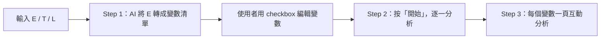
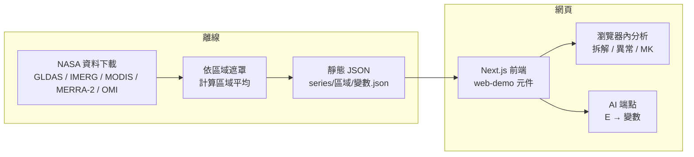

# Earth System Trend Detective：產品規格（草稿 v0.1）

> NASA Space Apps Challenge 2026「Be An Earth System Trend Detective!」參賽規格。
> 更新日期：2026-11-15（Asia/Taipei）。流程依據 `FLOW.md`；本文件只涵蓋 FLOW.md 的內容，其他延伸功能列在第 9 節，之後再討論。

## 1. 一句話

使用者用自然語言描述一個地球事件（例如「2021 年台灣大旱」），選定時間與地點；系統用 AI 推薦相關的 NASA 變數，對每個變數扣除季節循環與長期趨勢，把事件前後的異常畫在可互動的數線上，讓使用者像偵探一樣判斷：這個事件在資料裡看得到嗎？有多不尋常？背後的長期趨勢又是什麼？

## 2. 已確認決策

| 項目 | 決定 |
| --- | --- |
| 主要使用者 | 高中、大學學生及具科學背景的一般大眾（官方建議的受眾） |
| 與舊 Aqua Trend 的關係 | 重新界定範圍；可沿用的資產（區域圖層、GLDAS 下載管線、趨勢引擎、`web-demo` 前端元件）從 git 還原後再利用 |
| 資料取得 | 預先計算：離線管線把各區域、各變數的時間序列先算好，輸出靜態 JSON |
| 範圍 | 先實作 FLOW.md 的流程，其餘功能之後再加 |
| 視覺風格 | 沿用 `web-demo` branch 的元件樣式；頁面內容與版面可以大改 |

## 3. 使用者輸入

| 代號 | 輸入 | 形式 | 說明 |
| --- | --- | --- | --- |
| E | 事件 | 自然語言 | 例如「2021 年台灣春季大旱」「2022 巴基斯坦洪水」「亞馬遜野火」 |
| T | 時間 | 區間 `[t_start, t_end]` | 事件發生期間；可由 E 自動帶入建議值，使用者再修改 |
| L | 地點 | 地球點選，或自然語言 | 點選沿用 `web-demo` 的地球選區；用文字輸入時，解析成區域後在地球上標示出來讓使用者確認 |

L 必須對應到區域目錄中的一個區域（流域、H3 網格、命名研究區、海域、冰蓋等），因為資料是依區域預先計算的。如果自然語言地點對應不到任何區域，就提示使用者改用點選。

## 4. 流程



### Step 1：事件 → 變數

- 用 AI（優先用低延遲的快速模型，最好是開源模型）把 E 轉成變數清單 `{v_i}`。
- **AI 只能從變數目錄（第 6 節）裡挑選**，不能自己發明變數。輸出格式固定：

  ```json
  {
    "variables": [
      {"id": "precip", "reason": "乾旱最直接的訊號是降水偏少", "expected": "negative"}
    ],
    "suggested_time": {"start": "2020-10", "end": "2021-05"},
    "suggested_place": "台灣本島"
  }
  ```

- 每個變數附上一句淺白的理由，以及預期的異常方向（偏高或偏低）。這可以當成給學生的「假說」，到 Step 3 再用資料驗證。
- 使用者用 checkbox 增刪變數；目錄裡沒被選到的變數也能手動勾選。
- 備案：AI 無法使用時，改用關鍵字對照表（例如「乾旱」對應降水、土壤水、蒸散、氣溫、植被指數）。Demo 不能因為 AI 服務掛掉就中斷。

### Step 2：分析

使用者按下「開始」後，系統對每個勾選的 `v_i` 載入區域 L 的預先計算序列，並執行以下分析。計算量很小，在瀏覽器內完成即可。

1. **拆解序列**：`x(t) = 長期趨勢 + 季節循環 + 殘差`
   - 長期趨勢：線性趨勢。
   - 季節循環：各月份的平均值（月氣候值）。
   - **趨勢與季節循環只用基準期擬合，基準期不含事件期間 T 及前後緩衝**，避免事件本身把基準拉偏。
2. **殘差（異常）**：`r(t) = x(t) − 趨勢 − 季節`，同時算出標準化異常 `z(t) = r(t) / σ_r`。
3. **事件視窗**：取 `[t_start − 1 年, t_end + 1 年]`，在數線上用顏色標示 T。
4. **事件有多不尋常**：
   - 事件期間的平均異常與 z 值。
   - 事件期間異常在整段歷史殘差中的百分位，例如「過去 25 年中第 2 低」。
5. **長期趨勢本身也要回報**（官方題目的必要項目）：
   - 變化速率，單位是「原單位／每十年」。
   - Mann–Kendall 檢定 p 值（考慮自相關修正）。
   - Sen's slope 及 95% 信賴區間。
   - 判定「顯著／不顯著」。不顯著時，估計大約還需要幾年資料才可能達到顯著。

### Step 3：每個變數一頁互動分析

- 每個變數一頁，以分頁（tab）切換；頁首顯示變數名稱、淺白定義、單位、資料來源，以及觀測或模型的標示。
- **主體是數線（時間序列圖）**：
  - 預設顯示事件前後一年的殘差，事件期間用色塊標示。
  - 可以縮放、平移、拖曳選取區間。
  - 可以切換圖層：原始值／季節循環／長期趨勢／殘差。
- **分析工具**（放在側欄或收合面板，保持主畫面乾淨）：
  - 選取區間的統計：平均異常、z 值、百分位、區間內趨勢與 p 值。
  - 同期比較：把各年份相同月份的異常疊在一起，看這次是否特別。
  - 完整期間檢視：一鍵切換到全時段，看長期趨勢與信賴區間。
  - 假說對照：AI 預期的方向和實際異常方向是否一致，用簡單的 ✓／✗ 標示。
  - 匯出：CSV 與分析參數紀錄。
- **介面原則**：功能多，但畫面不雜亂。主畫面只放數線和一張結論卡，其他工具收在面板裡。
- **結論卡範例**：「2021 年 3–5 月台灣降水比正常少 62%（z = −2.4，1998 年以來第 1 低）。長期趨勢：−3.1 mm/月/十年，p = 0.21，不顯著。」

## 5. 統計方法細節

| 項目 | 做法 |
| --- | --- |
| 時間解析度 | 月資料（MVP）；見第 10 節的待決問題 |
| 季節循環 | 基準期內各月平均；若序列夠長，可改用 STL 拆解 |
| 長期趨勢 | 基準期的最小平方法線性趨勢，用於扣除；回報時用 Sen's slope 搭配 Mann–Kendall |
| 自相關 | Mann–Kendall 使用 Hamed–Rao 修正，或先做 prewhitening；同時回報有效樣本數 |
| 缺值 | 單一月份缺值不補；一年缺值超過 3 個月時，該年不計入季節循環的擬合 |
| 結果可重現 | 每個結果都附上資料版本、基準期、實際使用的期間及樣本數 |

統計核心以 TypeScript 實作，在瀏覽器執行；離線再用 Python（`scipy`、`pymannkendall`）對同一批資料交叉驗證，確認兩邊結果一致。

## 6. 變數目錄（MVP 候選，約 12 項）

| id | 名稱 | 來源 | 類型 |
| --- | --- | --- | --- |
| `tair` | 近地表氣溫 | GLDAS / MERRA-2 | 模型 |
| `precip` | 降水 | GPM IMERG | 觀測 |
| `et` | 蒸散 | GLDAS | 模型 |
| `soil_top` | 表層土壤水 | GLDAS | 模型 |
| `root_zone` | 根層土壤水 | GLDAS | 模型 |
| `swe` | 積雪水當量 | GLDAS | 模型 |
| `runoff` | 地表逕流 | GLDAS | 模型 |
| `tws` | 陸地總儲水 | GLDAS（或 GRACE） | 模型／觀測 |
| `ndvi` | 植被指數 | MODIS | 觀測 |
| `aod` | 氣膠光學厚度 | MODIS / MERRA-2 | 觀測／模型 |
| `ozone` | 臭氧柱總量 | OMI | 觀測 |
| `sst` | 海表溫度 | MERRA-2 / MODIS | 觀測／模型 |

每個變數都要有：給學生看的一句話定義、單位、時空解析度、資料期間，以及適用範圍（陸地、海洋或全部）。舊 `variables.json` 已經有一部分內容，可以沿用。

## 7. 系統架構



- **前端**：Next.js、React、three.js 地球、d3 圖表、Tailwind，全部沿用 `web-demo`。
- **資料**：每個區域、每個變數一個 JSON，內容是月序列加上 metadata。舊管線已經做到 GLDAS，需要再擴充 IMERG、MODIS 等資料源。
- **AI**：一個輕量 API route，或 serverless function。這是唯一需要後端的部分；其他頁面都是靜態輸出。
- **區域**：沿用舊的區域遮罩與 geojson 圖層，包括流域、H3、命名區、海域與冰蓋。

## 8. Demo 事件（預先驗證）

挑 2–3 個資料上看得清楚的事件，先確認分析結果合理，再拿來當展示範例：

1. 2021 台灣春季大旱：預期降水、土壤水、TWS 偏低。
2. 2022 巴基斯坦洪水：預期降水、逕流、土壤水偏高。
3. 一個大氣事件，例如野火煙霧或疫情封城期間的 AOD 變化。

## 9. 之後再討論（不在本版範圍）

- 引導式提問流程（「你想研究什麼、在哪裡？」）
- 可觀看的 demo 導覽動畫
- 趨勢地圖：各區域的趨勢與顯著性，呈現「這裡上升、那裡下降」
- 跨變數關聯：舊 Aqua Trend 的延遲相關分析
- 水晶球視覺

## 10. 待決問題

1. **時間解析度**：事件前後一年用月資料只有 24 個點以上，對颱風這類短事件太粗。要不要為 demo 事件額外準備日資料？
2. **AI 模型**：FLOW.md 提到的「jev」是指哪個模型？要用開源模型自行架設，還是先用 API 跑 demo？部署在哪裡？
3. **自然語言地點的解析**：由同一個 AI 呼叫一起處理，還是另外用地名查詢（geocoding）再對應到區域？
4. **基準期**：固定用某段期間（例如 2001–2020），還是用「全部期間扣掉事件視窗」？
5. **區域範圍**：要預先計算全部區域層，還是先只做 demo 事件需要的區域加上一層全球網格？
6. **分工與剩餘時間**：資料管線、統計、前端、AI 各由誰負責？
