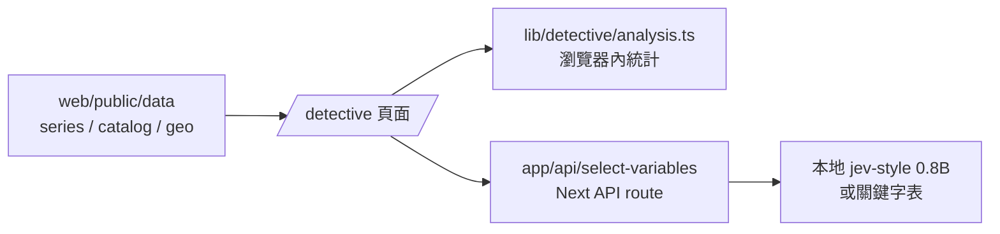

# Earth System Trend Detective：產品規格 v1

> NASA Space Apps Challenge 2026「Be An Earth System Trend Detective!」。更新日期：2026-11-15（Asia/Taipei）。
> 流程來源：[`docs/FLOW.md`](docs/FLOW.md)。實作分工與整合方式：[`docs/INTEGRATION.md`](docs/INTEGRATION.md)。
> 介面約定：[`web/lib/detective/contracts.ts`](web/lib/detective/contracts.ts)。
> 原始資料：團隊分享站 http://meow1.csie.ntu.edu.tw:3266/，盤點與使用規則見 [`docs/DATA_SHARE.md`](docs/DATA_SHARE.md)。
> 本文件取代 `docs/earth-system-*.md`（舊研究者導向規格，保留作參考，衝突時以本文件為準）。

## 1. 一句話

學生輸入一個地球事件（「2021 台灣大旱」），選定時間與子流域；系統推薦相關的 NASA 變數，扣除季節循環與長期趨勢後，把事件前後的異常畫在可互動的數線上，回答：**這個事件在資料裡看得到嗎？有多不尋常？背後的長期趨勢是什麼、顯不顯著？**

## 2. 已確認決策

| 項目 | 決定 |
| --- | --- |
| 使用者 | 高中、大學學生與具科學背景的大眾 |
| 介面原則 | 精簡、不雜亂；主畫面只放數線與結論卡，其餘收進面板 |
| 區域 | **只用 basin4 子流域**（1,313 個有序列）；不支援 hex、海域、命名區 |
| 資料 | 只用月資料；讀取 `web/public/data/series/<區域>.json`（series-2），不在查詢時下載，沒有 Python 後端 |
| 變數 | 以 12 個「類別」為單位（降水、蒸散、土壤水…），每類預設一個資料層，可切換同類其他產品 |
| AI | 本地開源決策模型（`jev-style` 0.8B，無 API key），對每個類別問「是／否有關」；失敗時退回關鍵字表 |
| 基準期 | 全期間扣除 `[事件起 − pad, 事件止 + pad]`，用來擬合趨勢與季節循環 |
| 頁面 | 單一路由 `/detective`，變數用分頁切換，完整狀態寫入 URL |
| 前端基底 | `web-demo` 的 Next.js 元件與樣式；branch `trend-detective` |

## 3. 使用流程


### Step 0：輸入

| 代號 | 內容 | 方式 |
| --- | --- | --- |
| E | 事件 | 文字框；旁邊 3 個預設事件按鈕，一按帶齊 E/T/L/變數 |
| T | 期間 `YYYY-MM..YYYY-MM` | 從 E 用正規表示式抓年份與月份當建議值；使用者在時間軸上確認或修改 |
| L | 子流域 | 地球上點選 basin4；或文字搜尋（沿用 `RegionSearch`）；選中後在地球上亮起確認 |

選擇器的設定永遠優先於從文字推出的建議。

### Step 1：事件 → 變數

- 前端呼叫 `POST /api/select-variables`，對 12 類別各問一次：「事件〈E〉與〈類別淺白定義〉有關嗎？」
- 機率 ≥ 門檻（預設 0.5，工作線 D 依測試調整）就預先勾選，旁邊顯示小機率條。
- 使用者用 checkbox 增刪；該區域沒有資料的類別灰掉不能選。
- 模型不可用或逾時 5 秒 → 關鍵字表；畫面小字標示來源。預設事件的變數直接寫死，不呼叫 AI。

### Step 2：分析（每個勾選類別）

1. 取該區域、該類別資料層的月序列。
2. 基準期 = 全期間扣除事件前後 pad（預設 12 個月）。
3. 用基準期擬合線性趨勢與 12 個月季節循環 → 殘差 `r = x − 趨勢 − 季節`，`z = r / σ_基準`。
4. 事件期間：平均殘差、平均 z、在歷史同長度區間中的百分位與名次（「1998 年以來第 2 低」）。
5. 長期趨勢（官方必要項目）：Sen's slope（原單位／十年）、95% 信賴區間、Mann–Kendall p（自相關修正），顯不顯著；不顯著時估計需要多少年資料。

缺值一律 `null`，不補值、不當 0；某年缺超過 3 個月，該年不參與季節循環擬合。

### Step 3：變數分頁

```
┌ 分頁：降水 | 土壤水 | 陸地儲水 ─────────────────────────┐
│ 降水（GPM IMERG，觀測）· mm/day · 一句話定義            │
│ ┌ 結論卡 ────────────────────────────────────────────┐ │
│ │ 2021-02..05 降水比正常少 62%（z = −2.4），1998 年以來 │ │
│ │ 第 1 低。                                            │ │
│ └────────────────────────────────────────────────────┘ │
│ [原始][季節][趨勢][殘差]                                 │
│ ────────── 數線（事件期間著色，可縮放、拖曳選取）───────── │
│ 選取區間：平均異常 · z · 百分位                          │
│ ▸ 長期趨勢（收合）：−3.1 mm/月/十年，95% CI […]，p=0.21  │
└────────────────────────────────────────────────────────┘
```

**MVP 工具**：縮放／拖曳選取、圖層切換（原始／季節／趨勢／殘差）、選取區間統計、長期趨勢面板（預設收合）。

**第二優先**：總覽分頁（所有變數小圖並排）、同期比較（各年同月份疊圖）、假說 ✓／✗（AI 或預設事件的預期方向 vs. 實際）、CSV 匯出。

## 4. 變數類別（AI 投票的對象）

| 類別 | 預設層 | 淺白定義（工作線 E 定稿） |
| --- | --- | --- |
| `precip` | `p_imerg` | 從天上落下的雨和雪有多少 |
| `et` | `et_m2` | 地面和植物把水送回空氣中的量 |
| `soil` | `sm_root` | 植物根部所在土層裡有多少水 |
| `tws` | `tws` | 地表、土壤、地下水加起來的總水量變化 |
| `runoff` | `runoff` | 下雨後沒被吸收、流進河裡的水 |
| `snow` | `swe` | 積雪融化後等於多少水 |
| `tair` | `tair` | 地面附近的空氣溫度 |
| `vpd` | `vpd` | 空氣有多「渴」，越大越容易把水吸走 |
| `energy` | `rn` | 地表吸收的淨輻射能量 |
| `wind` | `wind` | 近地面風速 |
| `ndvi` | `ndvi` | 植物有多綠、多茂盛 |
| `sst` | `sst` | 海表溫度（子流域多為陸地，通常不可用） |

資料層細節（產品、單位、期間、caveat）見 `web/public/data/catalog/variables.json`；caveat 不為 null 時必須顯示。

## 5. 預設事件

| id | 事件 | T | L（basin4） | 變數 | 預期 |
| --- | --- | --- | --- | --- | --- |
| `taiwan-2021-drought` | 2021 台灣春季大旱 | 2021-02..2021-05 | `b4-4040046370` 台灣 | precip, soil, tws, ndvi | 全部偏低 |
| `pakistan-2022-flood` | 2022 巴基斯坦洪水 | 2022-07..2022-09 | `b4-4040879050` Indus（巴基斯坦） | precip, runoff, soil, tws | 全部偏高 |
| `australia-2019-fire` | 2019–20 澳洲黑色夏季（乾旱與野火） | 2019-09..2020-01 | `b4-5040070710` 澳洲東南 | precip, soil, tair, ndvi | 降水、土壤、植被偏低；氣溫偏高 |

驗收：每個事件至少一個變數 |z| ≥ 2 且方向符合預期；不符就換區域或事件（工作線 E 負責）。目錄沒有 AOD，所以野火事件以乾熱條件呈現。

## 6. 架構



- 前端：Next.js 16、React 19、three.js 地球、d3 圖表、Tailwind 4（沿用 `web-demo`）。
- 統計：重用 `web/lib/stats.ts`（`mannKendall`、`senSlope`、`monthlyClimatology`、`lag1Autocorrelation`…）。
- AI：本地模型由 Next API route 透過子程序或本地 HTTP 呼叫；部署到靜態主機時自動退回關鍵字表。

## 7. 不做（本版）

hex／海域／命名區、日資料、跨變數關聯、水晶球、Python 後端、全球熱點推薦、使用者帳號。
