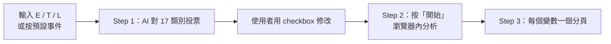
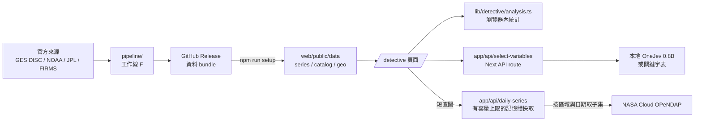
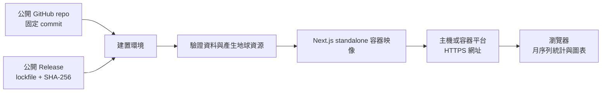

# Earth System Trend Detective：產品規格 v1

> NASA Space Apps Challenge 2026「Be An Earth System Trend Detective!」。更新日期：2026-11-15（Asia/Taipei）。
> 流程來源：[`docs/FLOW.md`](docs/FLOW.md)。實作分工與整合方式：[`docs/INTEGRATION.md`](docs/INTEGRATION.md)。
> 介面約定：[`web/lib/detective/contracts.ts`](web/lib/detective/contracts.ts)。
> 公開 repo 部署規格：本文件 §7。建置、資料下載或 CI/CD 工作先讀該節；現有操作指令見 [`deploy/README.md`](deploy/README.md)。
> 原始資料：團隊分享站 http://meow1.csie.ntu.edu.tw:3266/（暫時，只供開發參考），盤點與使用規則見 [`docs/DATA_SHARE.md`](docs/DATA_SHARE.md)。網站資料由 `npm run setup` 從 GitHub Release 下載。
> 本文件取代 `docs/earth-system-*.md`（舊研究者導向規格，保留作參考，衝突時以本文件為準）。

## 1. 一句話

學生輸入一個地球事件（「2021 台灣大旱」），選定時間與子流域；系統推薦相關的 NASA 變數，扣除季節循環與長期趨勢後，把事件前後的異常畫在可互動的數線上，回答：**這個事件在資料裡看得到嗎？有多不尋常？背後的長期趨勢是什麼、顯不顯著？**

## 2. 已確認決策

| 項目 | 決定 |
| --- | --- |
| 使用者 | 高中、大學學生與具科學背景的大眾 |
| 介面原則 | 精簡、不雜亂；主畫面只放數線與結論卡，其餘收進面板 |
| 區域 | **只用 basin4 子流域**（1,313 個有序列）；不支援 hex、海域、命名區 |
| 資料 | 只用月資料；讀取 `web/public/data/series/<區域>.json`（series-2），不在查詢時下載，統計不需要 Python 後端 |
| 原始碼發布 | GitHub public repo：`https://github.com/oliiiiiiiiii/aqua-trend`；使用 HTTPS 匿名 clone，部署以明確的 commit SHA 為版本 |
| 資料發布 | 網站資料**不進 git**。工作線 F 將處理後資料發布為公開 GitHub Release 附件；以 `web/data.lock.json` 的版本與 SHA-256 下載、驗證。匿名建置的要求與現況見 §7；網站與 setup 不依賴暫時的團隊分享站 |
| 變數 | 以 17 個「類別」為單位（降水、蒸散、土壤水…），每類預設一個資料層，可切換同類其他產品；只提供年資料的 SO₂ 暫不開放月分析 |
| AI | D 評估後選用本地 OneJev1.6-0.8B（無 API key），對每個類別問「是／否有關」；失敗時退回關鍵字表。另可明確設定線上端點，回應標示 `online-model` |
| 基準期 | 全期間扣除 `[事件起 − pad, 事件止 + pad]`，用來擬合趨勢與季節循環 |
| 頁面 | 單一路由 `/detective`，變數用分頁切換，完整狀態寫入 URL |
| 前端基底 | `web-demo` 的 Next.js 元件與樣式；branch `main` |

## 3. 使用流程



### Step 0：輸入

| 代號 | 內容 | 方式 |
| --- | --- | --- |
| E | 事件 | 文字框；旁邊 3 個預設事件按鈕，一按帶齊 E/T/L/變數 |
| T | 期間 `YYYY-MM..YYYY-MM` | 從 E 用正規表示式抓年份與月份當建議值；使用者在時間軸上確認或修改 |
| L | 子流域 | 地球上點選 basin4；或文字搜尋（沿用 `RegionSearch`）；選中後在地球上亮起確認 |

選擇器的設定永遠優先於從文字推出的建議。

### Step 1：事件 → 變數

- 前端呼叫 `POST /api/select-variables`，對 17 類別各問一次：「事件〈E〉與〈類別淺白定義〉有關嗎？」
- 機率 ≥ 門檻（預設 0.5，工作線 D 依測試調整）就預先勾選，旁邊顯示小機率條。
- 使用者用 checkbox 增刪；該區域沒有資料的類別灰掉不能選。
- 模型不可用或逾時 5 秒 → 關鍵字表；畫面小字標示來源。預設事件的變數直接寫死，不呼叫 AI。

### Step 2：分析（每個勾選類別）

1. 取該區域、該類別資料層的月序列。
2. 基準期 = 全期間扣除事件前後 pad（預設 12 個月）。
3. 用基準期擬合線性趨勢與 12 個月季節循環 → 殘差 `r = x − 趨勢 − 季節`，`z = r / σ_基準`。
4. 事件期間：平均殘差、平均 z、在歷史同長度區間中的百分位與名次（「1998 年以來第 2 低」）。
5. 長期趨勢（官方必要項目）：Sen's slope（原單位／十年）、95% 信賴區間、Mann–Kendall p（自相關修正），顯不顯著；不顯著時估計需要多少年資料。

缺值一律 `null`，不補值、不當 0；某年缺超過 3 個月，該年不參與季節循環擬合。

### Step 3：變數分頁

```
┌ 分頁：降水 | 土壤水 | 陸地儲水 ─────────────────────────┐
│ 降水（GPM IMERG，觀測）· mm/day · 一句話定義            │
│ ┌ 結論卡 ────────────────────────────────────────────┐ │
│ │ 2021-02..05 降水比正常少 62%（z = −2.4），1998 年以來 │ │
│ │ 第 1 低。                                            │ │
│ └────────────────────────────────────────────────────┘ │
│ [原始][季節][趨勢][殘差]                                 │
│ ────────── 數線（事件期間著色，可縮放、拖曳選取）───────── │
│ 選取區間：平均異常 · z · 百分位                          │
│ ▸ 長期趨勢（收合）：−3.1 mm/月/十年，95% CI […]，p=0.21  │
└────────────────────────────────────────────────────────┘
```

**MVP 工具**：縮放／拖曳選取、圖層切換（原始／季節／趨勢／殘差）、選取區間統計、長期趨勢面板（預設收合）。

**第二優先**：總覽分頁（所有變數小圖並排）、同期比較（各年同月份疊圖）、假說 ✓／✗（AI 或預設事件的預期方向 vs. 實際）、CSV 匯出。

## 4. 變數類別（AI 投票的對象）

| 類別 | 預設層 | 淺白定義（工作線 E 定稿） |
| --- | --- | --- |
| `precip` | `p_imerg` | 從天上落下的雨和雪有多少 |
| `et` | `et_m2` | 地面和植物把水送回空氣中的量 |
| `soil` | `sm_root` | 植物根部所在土層裡有多少水 |
| `tws` | `tws` | 地表、土壤、地下水加起來的總水量變化 |
| `runoff` | `runoff` | 下雨後沒被吸收、流進河裡的水 |
| `snow` | `swe` | 積雪融化後等於多少水 |
| `tair` | `tair` | 地面附近的空氣溫度 |
| `vpd` | `vpd` | 空氣有多「渴」，越大越容易把水吸走 |
| `energy` | `rn` | 地表吸收的淨輻射能量 |
| `wind` | `wind` | 近地面風速 |
| `ndvi` | `ndvi` | 植物有多綠、多茂盛 |
| `sst` | `sst` | 海表溫度（子流域多為陸地，通常不可用） |
| `aod` | `aod` | 空氣中的懸浮微粒阻擋光線的程度 |
| `ozone` | `to3_m2` | 從地面到高空整柱大氣有多少臭氧 |
| `vapor` | `tqv` | 整柱大氣的水氣凝結後等於多少水 |
| `so2` | `so2_emis` | 區域內大型點源每年排放多少二氧化硫 |
| `fire` | `fire_count` | 衛星每月偵測到多少植被火點 |

資料層細節（產品、單位、期間、caveat）見 `web/public/data/catalog/variables.json`；caveat 不為 null 時必須顯示。

F 新增資料由 Release `data-v2` 提供。`temporal_resolution: "annual"` 的層不可用於月尺度分解或顯著性檢定；目前 `so2_emis` 把年值重複在月份，前端顯示年資料限制並停用，直接 URL 也不能繞過。火點計數不是燃燒面積，臭氧柱不是近地面臭氧濃度。

## 5. 預設事件

| id | 事件 | T | L（basin4） | 變數 | 預期 |
| --- | --- | --- | --- | --- | --- |
| `taiwan-2021-drought` | 2021 台灣春季大旱 | 2021-02..2021-05 | `b4-4040046370` 台灣 | precip, soil, tws, ndvi | 全部偏低 |
| `pakistan-2022-flood` | 2022 巴基斯坦洪水 | 2022-07..2022-09 | `b4-4040879050` Indus（巴基斯坦） | precip, runoff, soil, tws | 全部偏高 |
| `australia-2019-fire` | 2019–20 澳洲黑色夏季（乾旱與野火） | 2019-09..2020-01 | `b4-5040070710` 澳洲東南 | precip, soil, tair, ndvi | 降水、土壤、植被偏低；氣溫偏高 |

驗收目標：每個事件至少一個變數 |z| ≥ 2 且方向符合預期。台灣依已確認決策保留原訂 2021-02..2021-05 與 `b4-4040046370`，目前未達此目標；不為通過門檻而縮短事件窗或更換子流域。F 已提供 AOD 與火點，可自行選用；既有野火預設仍保留原定四個變數。

驗證結果（pad = 12，預設資料層，詳見 [`docs/presets-validation.md`](docs/presets-validation.md)）：

| id | 通過（事件平均 z） | 未達預期 |
| --- | --- | --- |
| `taiwan-2021-drought` | 無 | `sm_root` −1.66、`ndvi` −1.51、`tws` −1.26、`p_imerg` −0.21（方向對但未達 2） |
| `pakistan-2022-flood` | `runoff` +24.4、`p_imerg` +6.25、`sm_root` +5.47 | `tws` +0.07 |
| `australia-2019-fire` | `ndvi` −2.69、`sm_root` −2.31 | `p_imerg` −1.04、`tair` +0.20 |

台灣 2021-04..05 的敏感度比較曾達門檻，但未採用為預設；三個事件的時間、區域與變數均保留原訂設定。未達門檻的資料層仍保留，呈現預期方向與統計異常程度的差別。

## 6. 架構



- 前端：Next.js 16、React 19、three.js 地球、d3 圖表、Tailwind 4（沿用 `web-demo`）。
- 統計：重用 `web/lib/stats.ts`（`mannKendall`、`senSlope`、`monthlyClimatology`、`lag1Autocorrelation`…）。
- 網站後端與部署：Next.js／Node.js standalone，網站、`/api/select-variables/` 與 `/api/daily-series/` 同一容器。公開部署契約見 §7，操作指令見 [`deploy/README.md`](deploy/README.md)。
- AI：本地模型由 Next API route 透過 HTTP 呼叫獨立的選變數服務；模型不可用時退回關鍵字表，前端在 API 不可用時也有同一份備案。模型安裝與評估見 `tools/selector/README.md`。

## 7. 公開 repo 部署規格

### 7.1 目標與交付物

任何人都能從公開 repo 與公開資料附件建置月資料分析網站，不需要維護者的 GitHub、NASA 或模型帳號。日資料查詢是選用功能，需部署者於執行期提供 Earthdata token。交付物是可搬到其他主機執行的容器映像，保留網站、資料與 API。目標主機或雲端平台尚未指定，本規格不綁定廠商。

| 項目 | 契約 |
| --- | --- |
| 原始碼 | `https://github.com/oliiiiiiiiii/aqua-trend.git`；`main` 為整合分支，每次部署記錄實際 commit SHA |
| 網站資料 | 公開 GitHub Release 附件；`web/data.lock.json` 的 `repo`、`tag`、`asset`、`sha256` 是唯一版本依據 |
| 資料封裝 | 包含 `web/public/data` 與 `web/data`；包含目錄、區域序列與地球前處理輸入，略過可重建的 `public/data/gen` 與 `.bundle` 標記 |
| 執行映像 | 由 Dockerfile 建置的 Next.js／Node.js standalone；包含驗證後資料、前端資源與 API |
| 部署紀錄 | 原始碼 SHA、資料 tag／SHA-256、映像 tag／digest、目標平台、正式 URL、健康檢查結果 |

資料 `.tar.gz` 是建置輸入；容器映像是可執行的發布產物。下載資料附件不等於取得容器映像，repo 公開也不代表網站已經上線。

### 7.2 匿名取得原始碼與資料

1. 以公開 HTTPS URL clone repo，切到預定部署的 commit。
2. 讀取該 commit 的 `web/data.lock.json`，以匿名 HTTPS 取得對應 Release 附件。
3. 先比對完整 SHA-256；一致後才解壓並寫入 `.bundle`。下載失敗或校驗不符時，建置須失敗，保留原有可用資料。
4. 解壓後檢查目錄、前處理輸入與索引引用的區域序列檔，再進入建置。

公開來源的讀取不以 SSH key、`gh auth login`、`GITHUB_TOKEN` 或 Earthdata token 為必要條件。`--file <archive>` 保留為離線或預先下載的入口，仍執行相同校驗。資料更新使用新的 Release 版本與 lockfile，不以同名附件替換既有版本。

**自動化目標**：乾淨的建置環境執行 `npm ci`、`npm run setup` 即可匿名取得鎖定資料。現行腳本仍需補上匿名下載路徑；在完成之前，使用 [`deploy/README.md`](deploy/README.md#build-on-a-new-host) 的公開下載加 `setup --file` 流程。這個差異是待實作項目，不能將目標流程寫成已驗證功能。

### 7.3 建置與執行邊界



- 建置端具備 Git、Node.js 24／npm、Docker／Compose，以及下載和解壓工具。先在主機或 CI runner 準備資料，再交給 Docker build；目前 Dockerfile 會在建置前檢查資料，不會自行補下載。
- 映像包含 `/detective/`、`POST /api/select-variables/`、`GET /api/daily-series/`、`/healthz/` 與必要靜態資料。部署平台須能保留伺服器端 API；純靜態輸出不滿足本規格。
- 執行端只需要映像與容器執行環境。服務在容器內監聽 `0.0.0.0:8080`；外部連接埠與 HTTPS 由主機、反向代理或平台設定。
- 沿用 Compose 的非 root 使用者、唯讀根檔案系統及暫存目錄設定。月資料已封裝在映像中，執行時不再下載 Release 或模型權重。啟用日資料時只取指定區域、短日期區間的 NASA 子集，在記憶體內聚合後丟棄原始格網，不建立完整日資料庫，也不依賴本機開發伺服器。
- 每次發布保存映像 digest。跨 CPU 架構部署時，為目標架構建置並驗證；需要跨次完全重現映像位元組時，另外固定基底映像 digest，目前的 `node:24-alpine` 標籤仍會更新。

### 7.4 模型與部署憑證

預設使用 `SELECTOR_BACKEND=keyword`，無模型服務或 API key 時仍能完成整個分析流程。選用本地或線上模型時，透過執行期環境變數設定；模型服務與權重另行部署。欄位與預設值以 [`deploy/.env.example`](deploy/.env.example) 為準。

公開讀取原始碼、資料與公開映像不需登入。發布映像、寫入 repo 或操作雲端平台則使用維護者／CI 的寫入權限；這些憑證不進 Git、Docker build argument、映像、前端環境變數或輸出紀錄。模型服務不可用、回應無效或超時時，保留關鍵字備案與來源標示。

日資料使用 `EDL_TOKEN` 或 `EDL_TOKEN_FILE`，由平台 secret 或唯讀掛載提供；變數不得加上 `NEXT_PUBLIC_`。未提供、過期或被拒絕時，日資料顯示服務不可用，月資料功能持續可用。Earthdata token 不參與建置或公開 Release 下載。

### 7.5 發布、更新與回滾

發布順序為：固定原始碼版本 → 匿名取得鎖定資料 → 型別與必要測試 → 建置映像 → 容器驗收 → 發布映像 → 更新目標服務 → 外部網址驗收。任何前置階段失敗，都不替換目前服務。

若建立 CI/CD，PR 執行檢查但不更新正式環境；正式發布使用指定的 `main` commit 或發布 tag。平台、registry、環境與觸發規則須記錄在部署設定，不能僅因 repo 可公開讀取就推定已設定自動部署。目前 repo 尚未建立這套工作流程。

映像使用能對應 commit 的 tag，部署保存 digest，保留上一版可用映像。資料 lockfile 改變時重新取得資料並建置；回滾時切回上一版映像，程式與資料一起回復。單純更改模型執行期設定時，重新建立服務即可。

### 7.6 驗收與目前狀態

部署完成須同時滿足下列條件；本機容器通過不等於外部部署已完成：

| 驗收 | 通過條件 |
| --- | --- |
| 匿名建置 | 無 GitHub／NASA token、未登入 `gh` 的乾淨環境，可從公開 repo 和鎖定 Release 完成資料準備與建置 |
| 資料校驗 | 缺檔、錯誤 SHA-256、舊 `.bundle` 標記皆停止建置；不將缺測值改為零 |
| 服務 | `/healthz/` 回傳 HTTP 200 與 `ok`；網站、目錄與區域序列可讀取 |
| API | 預設回傳 17 類投票及 `source: "keyword-fallback"`；無效輸入回傳 400；無需先啟動模型 |
| 操作流程 | 三個預設事件、變數／產品切換、圖表、URL 重新整理與 375px 手機流程可用 |
| 資料限制 | 年度 SO₂ 保持月分析停用，各產品 caveat 顯示；科學驗收沿用 §4–5 |
| 發布內容 | `.env`、`data/.bundle` 與不存在路徑回傳 404；映像可在另一台目標架構主機啟動 |
| 正式上線 | 外部 HTTPS 網址的頁面、資料及 API 驗收通過，並記錄版本組合與回滾版本 |

截至 2026-11-15，公開 repo、`data-v2` 附件、lockfile、Docker／Compose 與本機容器驗證已具備。`setup` 自動匿名下載、CI/CD、registry 發布、目標主機及外部 HTTPS 驗收仍待實作或選定；本次規格改寫只更新文件。

### 7.7 月資料與按需日資料

- 月資料 bundle、月尺度基準期、z 值、歷史排名與趨勢分析維持既有契約。日資料不填補月缺值，也不套用月尺度的季節模型或標準差。
- 所選事件期間最多 1 個曆月時，僅對目前開啟且有日資料 adapter 的產品自動呼叫 API；更長期間不呼叫。門檻集中於 `web/lib/detective/daily.ts`，依實測調整，不由 AI 在查詢時決定。
- 前端將月份分成最多 3 天的請求，順序載入並顯示完成進度；尚未載入、已確認缺值及服務失敗是不同狀態。切換條件或離開分頁會中止舊請求；無論日資料狀態如何，月資料仍可使用。
- API 只接受已知 basin4、已登錄產品及合法完整 UTC 日期，拒絕任意來源 URL 與大範圍請求。NASA 請求有併發、時間及回應大小上限；憑證只發送到固定 NASA HTTPS 資料端點。
- 原始子集僅在記憶體中處理。快取只保留聚合後序列，容量與有效期受限；重新啟動可清空，不需要永久磁碟或資料庫。
- 日資料公開來源版本、單位、UTC 日聚合規則、空間平均方法、取得時間與缺值。每日原生格網中心遮罩／面積權重和月資料 0.5° 方法不同，不宣稱數值完全相同。產品無日資料時不插值、不替換成另一個產品。

API、產品對應及效能證據見 [`docs/daily-data.md`](docs/daily-data.md)。此節依後續確認的按需資料需求新增，取代舊文件對「查詢期間一律不得取得新資料」的限制。

## 8. 不做（本版）

偵探頁不做 hex／海域／命名區、跨變數關聯、Python 統計後端、全球熱點推薦、使用者帳號。日資料限 §7.7 的短期原始值細節，不新增日尺度異常／趨勢模型。選用的本地 AI 服務可使用 Python，與瀏覽器內的統計分析分開。

2026-11-15 UI 改版：偵探頁改用水晶球（推翻原「不做水晶球」），舊的 `/explore` 展示頁與合成 leads 已刪除；見 `docs/ux-refresh.md`。
