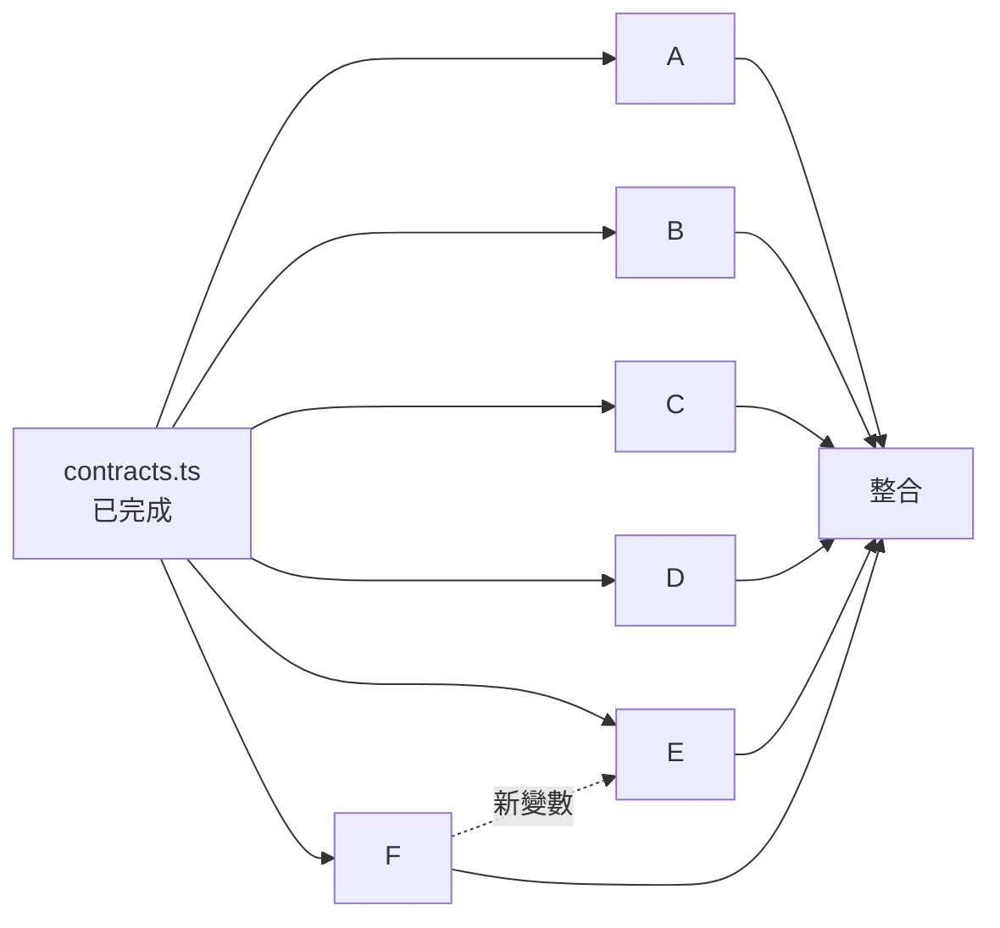

# 實作分工與整合說明

> 給人類與 agent。先讀 [`SPEC.md`](../SPEC.md)，再讀 [`web/lib/detective/contracts.ts`](../web/lib/detective/contracts.ts)。
> 基底 branch：`main`。
>
> **主線整合狀態（2026-11-15）**：A、B、C、D、E、F 已合併；`/detective` 使用真實統計、圖表、類別與預設事件，選變數呼叫 D API，失敗時使用共用關鍵字備案。容器使用 Next.js／Node.js standalone，見 [`deploy/README.md`](../deploy/README.md)。資料更新為 `data-v2`：34 層、17 類別；SO₂ 年資料不提供月分析。台灣預設維持 2021-02..2021-05。
>
> **開始前先取得網站資料**（資料不在 git 裡）：`cd web && npm i && npm run setup`。
> repo 是私有的，下載需要已登入的 `gh`（`gh auth login`）或環境變數 `GITHUB_TOKEN`；也可以手動下載 Release 附件後執行 `npm run setup -- --file <檔案>`。`npm run dev` 會在資料不存在時自動執行 setup。

## 0. 規則

1. 每條工作線開自己的 branch：`td/a-stats`、`td/b-chart`、`td/c-input`、`td/d-ai`、`td/e-data`、`td/f-pipeline`，從 `main` 分出，PR 回 `main`。
2. **只改自己負責的檔案**（下表）。需要改 `contracts.ts` 時，PR 標題加 `[contract change]`，並同步更新本文件。
3. 依賴尚未完成時，用 contracts 裡的型別寫假資料先做，不要等。
4. 開始寫 Next.js 程式前，先讀 `web/AGENTS.md`（Next 16 有破壞性變更）。
5. `web/public/data/` 與 `web/data/` 是 setup 下載的產物，已被 `.gitignore` 忽略，**不可 commit**。要改資料只能由 F 發布新的 bundle。缺值是 `null`，不可當 0。
   程式碼裡的小型設定檔（例如 E 的 `presets.ts`、`categories.ts`）放在 `web/lib/detective/`，不要放進 `web/public/data/`。
   團隊分享站 http://meow1.csie.ntu.edu.tw:3266/ 是**暫時的**，只供 F 開發時參考；網站、setup 與最終管線都不可依賴它。詳見 [`docs/DATA_SHARE.md`](DATA_SHARE.md)。
6. 介面精簡：每加一個控制項，先問「能不能收進面板」。
7. 完成條件 = 該工作線的「完成檢查」全部打勾，且 `cd web && npm run typecheck` 通過。

## 1. 工作線

### A — 統計函式庫

| | |
| --- | --- |
| 負責檔案 | `web/lib/detective/analysis.ts`、`web/lib/detective/analysis.test.ts` |
| 輸入 | `MonthlySeries`、事件 `TimeRange`、`padMonths` |
| 輸出 | 實作 `AnalysisApi`：`decompose`、`intervalStats`、`trendStats` |
| 重用 | `web/lib/stats.ts`（`mannKendall`、`senSlope`、`monthlyClimatology`、`lag1Autocorrelation`、`normalCdf`） |

規則：
- 基準期 = 全期間扣除 `[event.start − pad, event.end + pad]`；趨勢（OLS）與季節循環只用基準期擬合。
- 某年缺值 > 3 個月，該年不參與季節循環擬合。σ 只用基準期殘差。
- `intervalStats` 的百分位：對全期間所有同長度滑動區間的平均殘差排序；名次方向依平均殘差正負。
- `trendStats`：在去季節化的全期間序列上算 Sen's slope（×120 換成每十年）與 95% CI；Mann–Kendall 用 Hamed–Rao 或 lag-1 有效樣本修正；`yearsToSignificance` 以「目前斜率不變、標準誤隨 n^−1.5 下降」粗估，超過 50 年回 null。

完成檢查：
- [ ] 合成資料測試：正弦季節 + 已知斜率 + 雜訊，`trend` 斜率誤差 < 5%，`seasonal` 還原正確。
- [ ] 在事件期間注入 −3σ 的異常，`intervalStats.meanZ` ≈ −3，名次第 1。
- [ ] 含 `null` 的序列不會產生 NaN 傳出；`null` 位置在輸出中仍是 `null`。
- [ ] 不依賴 DOM，可在 Node 執行（用 `node --test` 或 `npx tsx --test`）。

### B — 數線圖表與變數分頁

| | |
| --- | --- |
| 負責檔案 | `web/components/detective/SeriesChart.tsx`、`VariableTab.tsx`、`ConclusionCard.tsx`、`TrendPanel.tsx` |
| 輸入 | `Decomposition`、`IntervalStats`、`TrendStats`、變數 metadata（名稱、單位、產品、caveat、淺白定義） |
| 輸出 | `<VariableTab>`：顯示一個變數的完整 Step 3 畫面 |
| 重用 | `web/components/charts/TimeSeriesChart.tsx` 的樣式、`ChartTooltip`、`useElementWidth`、`time.ts` |

規則：
- 現有 `TimeSeriesChart` 沒有縮放；以 d3 加上滾輪縮放、拖曳平移、Shift+拖曳（或按鈕切換）選取區間。
- 預設視窗 = 事件前後 `padMonths`；事件期間用色塊標示；「全時段」按鈕。
- 圖層切換：原始／季節／趨勢／殘差（Segmented，沿用 `components/explore/Segmented.tsx`）。
- 選取區間時呼叫 `intervalStats`（由 props 傳入函式，不直接 import A 的實作以便先用假資料開發）。
- 結論卡文字格式見 SPEC §3 Step 3。趨勢面板預設收合。

完成檢查：
- [ ] 用假 `Decomposition` 在 `/dev/detective-chart` 頁可縮放、選取、切換圖層。
- [ ] `null` 斷線，不連線補值。
- [ ] 手機寬度（375px）不出現水平捲動。

### C — 輸入頁、流程與 URL 狀態

| | |
| --- | --- |
| 負責檔案 | `web/app/detective/page.tsx`、`web/components/detective/InputPanel.tsx`、`VariablePicker.tsx`、`DetectiveApp.tsx`、`web/lib/detective/url.ts`、`web/lib/detective/series.ts` |
| 輸入 | 預設事件（E）、`SelectResponse`（D）、`AnalysisApi`（A）、`<VariableTab>`（B） |
| 輸出 | `/detective` 完整流程 |
| 重用 | `components/globe/GlobeCanvas.tsx`、`components/explore/GlobePane.tsx`、`RegionSearch.tsx`、`regionUtils.ts` |

規則：
- 地球只開 basin4 圖層。注意：`web-demo` 的地球讀 `public/data/gen`（`npm run prep` 產生），序列則讀 `public/data/series/<id>.json`（series-2）。先確認兩邊 basin4 的 id 一致；不一致時在 `series.ts` 建對照，並回報。
- `series.ts`：`loadSeries(region, layer): Promise<MonthlySeries>`，讀 series-2 並從 `variables.json` 帶入單位；先查 `catalog/series_index.json` 決定哪些類別可選。
- T 的解析：E 中的 `YYYY` 或 `YYYY 年 M 月` → 建議期間；無月份時預設該年全年。
- 狀態全部存在 URL（實作 `UrlCodec`）；帶齊 `r` 與 `v` 時直接進分析分頁，demo 連結可直接開。
- 流程：輸入 → 按「找變數」（呼叫 D）→ checkbox → 按「開始」→ 分頁。

完成檢查：
- [ ] 三個預設事件按鈕一鍵進到分析分頁。
- [ ] 重新整理頁面狀態不變；複製 URL 到新分頁結果相同。
- [ ] 地球點選與文字搜尋都能選到 basin4，選中後地球高亮。

### D — AI 選變數

| | |
| --- | --- |
| 負責檔案 | `web/app/api/select-variables/`（`route.ts`、`online.ts`）、`web/lib/detective/keywords.ts`、`web/.env.example`、`tools/selector/`（本地模型啟動腳本與說明） |
| 輸入 | `SelectRequest` |
| 輸出 | `SelectResponse` |

規則：
- 本地開源決策模型，無 API key。候選：`jev-style`（0.8B，`pip install "jev-style[torch]"`）、`Phocinae-Largha-150M`（中英文、CPU 可跑）。先實測兩者在 10 個測試事件上的表現，選一個寫進 `tools/selector/README.md`。安裝指令與介面以官方說明為準。
- 對 17 類別各問一次是／否（問題文字用 SPEC §4 的淺白定義，原 12 類加上 F 的 aod／ozone／vapor／so2／fire）。
- 逾時 5 秒或模型不可用 → `keywords.ts` 中英文關鍵字表，`source: "keyword-fallback"`。
- `suggestedTime` 用正規表示式從 E 抽取（可與 C 共用函式，放在 `keywords.ts` 匯出）。
- 靜態部署時 API route 不存在：前端（C）收到錯誤時直接在瀏覽器端呼叫 `keywords.ts`。
- 選用線上後端：`SELECTOR_BACKEND=openai`（任何 OpenAI 相容 API）或 `systemone`（遠端 Jev 風格 API），預設仍是本地模型。此時 `source` 為 `online-model`（[contract change]），C 要顯示對應標示。設定見 `tools/selector/README.md`。

完成檢查：
- [ ] `tools/selector/eval.md`：10 個事件（乾旱、洪水、熱浪、野火、暴雪、颱風季、聖嬰…）的投票結果與人工判斷對照。
- [ ] 模型關閉時 API 仍在 1 秒內回傳關鍵字結果。

### E — 資料、目錄文字與預設事件

| | |
| --- | --- |
| 負責檔案 | `web/lib/detective/presets.ts`、`web/lib/detective/categories.ts`、`docs/presets-validation.md`、`README.md` |
| 輸出 | `PresetEvent[]`；17 類別的名稱、淺白定義（中英）、預設層、圖示；驗證報告 |

規則：
- 資料本身（從分享站或 Giovanni 產生 series-2）由工作線 F 負責。E 需要某個變數做預設事件時（例如澳洲野火要 FIRMS 火點或 AOD），向 F 提出，不自己寫管線。
- 以 SPEC §5 的三個事件為起點；用 Python 對 series-2 檔案重算殘差與 z，確認至少一個變數 |z| ≥ 2 且方向符合預期。不符就換子流域或事件，並更新 SPEC §5。
- 淺白定義給高中生看，一句話、不超過 30 字。
- README：專案介紹、如何執行（`cd web && npm i && npm run dev`）、對應官方題目要求的段落（變數選擇／區域／時間序列／變化速率／顯著性檢定各對應到哪個功能）。

完成檢查：
- [ ] `docs/presets-validation.md` 每個事件附 z 值表。
- [ ] A 完成後，用 A 的函式再跑一次，數值與 Python 差異 < 1%。

### F — 資料管線（分享站／Giovanni → series-2）

| | |
| --- | --- |
| 負責檔案 | `pipeline/`（新資料夾：下載、遮罩平均、寫出 series-2、打包 bundle 的腳本）、`web/data.lock.json`、`web/scripts/setup-data.mjs`、`docs/DATA_SHARE.md` |
| 輸入 | 官方資料來源（GES DISC、NOAA PSL、JPL、FIRMS、HydroSHEDS）、NASA Giovanni；開發時可參考分享站 http://meow1.csie.ntu.edu.tw:3266/ |
| 輸出 | GitHub Release 上的資料 bundle（`web/public/data` + `web/data`，series-2 格式不變），以及更新後的 `web/data.lock.json` |

**目前狀態**：`data-v2` 在 `data-v0` 上合併 F `80f3f6b` 的 34 層快照，新增八層並延長六個 MERRA-2 陸面替代產品。相較 `data-v1`，僅新增 `lst_night` 與 `rn_ceres`，原有序列不變。部署只依賴 GitHub Release；分享站產製的三層來源仍如實記在 metadata。管線、重跑依賴與已知限制見 [`pipeline/README.md`](../pipeline/README.md)。原始 `data-v0` 與舊管線仍可從 `5f22f14` 追溯。

**發布流程**（每次更新資料）：
1. 管線輸出到一個乾淨的目錄，結構是 `web/public/data/...` 與 `web/data/...`。
2. `tar -czf aqua-trend-data-vN.tar.gz web`，計算 `sha256sum`。
3. 建立 GitHub Release，tag 為 `data-vN`，上傳 tar 檔。
4. 更新 `web/data.lock.json` 的 `tag`、`asset`、`sha256`，開 PR。其他人 pull 之後執行 `npm run setup` 就拿到新資料。

**前提：分享站的資料會在你工作期間陸續上傳。** 目前 `gesdisc/`、`modis/`、`ceres/` 等資料夾是空的。不要假設清單固定，也不要因為某個資料夾是空的就停下來。

規則：
- **先讀 [`docs/DATA_SHARE.md`](DATA_SHARE.md)**。
- **最終管線必須從官方來源下載**，任何人都能用 Earthdata 帳號重跑。開發時可以暫時從分享站取檔加速，但不可寫死在管線裡。
- 需要 Earthdata 帳號（`~/.netrc`），帳密不可 commit。只有 F 需要；其他工作線只用 setup 下載的 bundle。
- 管線要能重跑：同一個資料來源再跑一次，只更新那一層，其他層不動。每個資料層在 `variables.json` 記錄來源（`share` 或 `giovanni`）和處理日期。
- 優先順序：
  1. 分享站上已有檔案、而且 series-2 還沒有的子流域變數：FIRMS 火點數（`fire_count`）、OMI SO₂、MOD10CM 積雪覆蓋。
  2. 分享站補上 `gesdisc/`、`modis/` 後，重算或延長既有資料層；補上 `m2aer` 時加 AOD。
  3. 官方來源下載太慢或不可行時，試 **NASA Giovanni**（見 DATA_SHARE.md「Giovanni」一節）。Giovanni 試不通就跳過，**繼續用 lockfile 鎖定的 Release 資料**，不要卡住。
- 新增類別時要改 `contracts.ts` 的 `CategoryId`，PR 標 `[contract change]`，並通知 D（關鍵字表）和 E（淺白定義）。
- 每次更新資料，在 `docs/DATA_SHARE.md` 的「處理紀錄」補一行：日期、資料層、來源、涵蓋期間、子流域數量。

完成檢查：
- [ ] 至少新增一個分享站變數，三個預設事件的子流域都有該層序列。
- [ ] 新序列抽查 3 個子流域，數值範圍與單位合理，缺值是 `null`。
- [ ] Giovanni：可用的話寫下用法與限制；不可用的話寫下原因。兩種情況都記在 DATA_SHARE.md。
- [ ] 重跑管線不會改到其他資料層。
- [ ] 新 bundle 已發布成 Release，`web/data.lock.json` 已更新，在乾淨的 clone 上 `npm run setup && npm run dev` 能跑。
- [ ] 管線不讀分享站也能完整跑完。

## 2. 相依關係

六條線彼此不阻塞：B 用假 `Decomposition`、C 用假 `SelectResponse` 與假 `VariableTab`、D 只依賴 contracts、E 先用現有 series-2、F 隨資料上傳持續更新。

## 3. 整合步驟（任何 agent 可執行）

1. `git checkout main && git pull && cd web && npm i && npm run setup`
2. 依序合併：F → E → A → D → B → C（C 最後，因為它把其他部分接起來）。F 之後若又更新資料，可以隨時再合併。每合併一個跑 `cd web && npm run typecheck`。
3. 衝突處理：除 `contracts.ts` 外，檔案擁有者的版本優先；`contracts.ts` 衝突時以較新的 `[contract change]` PR 為準並修正呼叫端。
4. 把 C 中的假資料替換成真實匯入：`analysis.ts`（A）、`VariableTab`（B）、`/api/select-variables`（D）、`presets.ts`／`categories.ts`（E）。
5. `npm run prep && npm run dev`，跑下方驗收清單。
6. 用 `web/scripts/shot.mjs`（Playwright）對三個預設事件截圖，放進 `docs/screenshots/`。

## 4. 驗收清單（整合完成條件）

- [x] 從首頁進 `/detective`，按任一預設事件，3 秒內看到分頁與結論卡。
- [x] 自由輸入「2021 台灣乾旱」→ 建議 T 為 2021 → 搜尋選台灣子流域 → 按「找變數」→ 至少勾選降水 → 開始 → 有結果。
- [x] 每個分頁：縮放、選取區間、圖層切換、趨勢面板都能用；趨勢面板顯示每十年速率、95% CI、MK p、顯著與否。
- [x] 關掉本地模型，流程仍可完成（關鍵字備案，畫面有標示）。
- [x] caveat 不為 null 的資料層有顯示警告。
- [x] 375px 寬度無水平捲動；淺色與深色主題都可讀。
- [x] `npm run typecheck` 與 `npm run build` 通過。

2026-11-15 C／D 整合驗收：`cd web && npx tsx --test lib/detective/*.test.ts components/detective/*.test.ts app/api/select-variables/*.test.ts` 共 161 項通過；Docker 內的 production build 通過。正式容器以 UID 1000、唯讀根檔案系統啟動，健康檢查與 API 通過，缺少的路徑／資料及 `.env`、`data/.bundle` 回傳 404。

Chrome／Playwright 在 1280px 與 375px 驗證三個預設事件、全部變數分頁、重新整理、分享 URL、搜尋與鍵盤操作、圖層、縮放、區間選取、pad 變更重設、趨勢面板、深淺主題及返回輸入頁。正式容器上的預設事件顯示時間為 0.22–1.07 秒（本機量測，非遠端效能保證），無頁面錯誤。另驗證地球選區、產品切換後的 NOAA caveat，以及遲到的模型回應不覆蓋新事件或手動勾選。

模型介面與線上來源以假回應測試；本次整合未下載或執行真實模型。D 的既有模型評估仍見 [`tools/selector/eval.md`](../tools/selector/eval.md)。台灣事件未達 |z| ≥ 2 的科學驗收限制仍保留，與上述操作流程驗收分開。

同日 F 整合後，上述 TypeScript 測試增至 168 項且全數通過，typecheck 與正式 Docker build 通過。另有 5 項 selector Python 測試、17 類中英定義一致性檢查及 9 項使用合成資料的管線回歸測試通過。`data-v1` 的 1,706 個序列檔通過 JSON、索引及有限數值檢查；29 組預設／替代產品統計與獨立 Python 重算的最大相對差異低於 1e-10%。這些檢查不代表已從原始觀測重新驗證 F 的所有科學數值。

F 的正式容器也在 Chrome 1280px／375px 驗證：17 類選項、四個新增月類別的真實圖表與 caveat、重新整理與 URL 還原正常；SO₂ 年資料不能勾選，直接開其 URL 也不會產生月尺度 z、百分位或趨勢檢定。無頁面錯誤或水平溢出。原有三個預設事件與台灣事件範圍維持不變。

F 後續更新 `80f3f6b` 以 `data-v2` 納入 MODIS 夜間地表溫度與 CERES 輻射，共 34 層。所有 48,567 組既有區域／資料層物件比對不變；manifest 重建後 34 層皆通過結構驗證，年度 SO₂ 仍不適用月分析。地表溫度產品的圖表標題與定義改為正確的地表溫度，避免沿用類別的氣溫文案。最終 TypeScript 測試 172 項、管線回歸測試 16 項全數通過。

最終 `data-v2` 正式 Docker build 與健康檢查通過；1280px／375px 驗證新增產品切換、caveat、URL 還原、三種地表溫度文案及年度資料限制，無頁面錯誤或水平溢出。

`data-v1` 已在獨立空目錄實際從 Release 下載、校驗與解包；最終 `data-v2` 已用發布檔完成 setup、prep 與容器資料檢查，GitHub 附件的 SHA-256 與 lockfile 一致。完整資料放在 Release，沒有重新加入 Git 追蹤。

真實資料截圖：[台灣](screenshots/taiwan-2021-drought.png)、[巴基斯坦](screenshots/pakistan-2022-flood.png)、[澳洲](screenshots/australia-2019-fire.png)。

## 5. 官方題目對應（評審看）

| 官方要求 | 功能 |
| --- | --- |
| 選擇變數 | Step 1 AI 投票 + checkbox，附淺白定義 |
| 取得特定區域資料 | basin4 子流域，地球點選或搜尋 |
| 產生並視覺化時間序列 | Step 3 數線，原始／季節／趨勢／殘差 |
| 變化速率 | 趨勢面板：Sen's slope，原單位／十年 |
| 顯著性檢定 | Mann–Kendall p、95% CI、需要幾年才顯著 |
| 示範案例 | 三個預設事件 |
| 用 AI 找變數 | 本地開源決策模型 |
