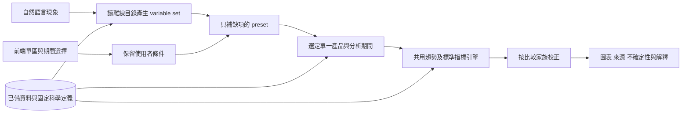

# Aqua Trend 地球系統趨勢探索技術規格

版本：1.0　日期：2026-11-14（Asia/Taipei）  
用途：交付實作 agents 的系統規格。本文定義預期行為，並不表示程式已實作。  
需求優先順序：本規格的已確認需求優先於舊版 README 與 `web/docs/build-spec.md` 中衝突的產品描述。

## 1. 產品目的與交付範圍

Aqua Trend 讓使用者以自然語言描述地球科學現象，例如「乾旱」「淹水」，由系統從既有變數目錄產生 variable set，使用已準備好的資料進行線性趨勢分析，並解釋變化速率、統計證據與限制。

系統提供兩類結果：

1. **相關環境變數的趨勢**：分析與現象相關的既有變數。
2. **現象本身的指標或事件趨勢**：分析事件頻率、持續時間、嚴重程度，或其他適用的標準指標；區分事件紀錄與依科學標準推算的指標。

交付目標是完整系統，包含前端、後端、共用分析引擎、preset、來源與不確定性展示、資料介面及驗收。一次整合交付；工期不構成刪減已確認需求的理由。團隊會後續補齊資料，實作以本規格的輸入契約及待資料狀態銜接。

NASA 題目的核心對應為：辨識變數、指定區域、呈現足夠長的時間序列、報告變化速率、評估趨勢顯著性。現象探索服務於科學探索與假設生成；預報及因果識別不屬本次交付要求。

## 2. 已確認需求

| 項目 | 確定行為 |
| --- | --- |
| 自然語言輸入 | 描述任意地球科學現象，產生既有目錄中的 variable set；不將支援範圍硬編碼為只有乾旱與淹水。實際可分析內容由已備資料與標準定義決定。 |
| 地點輸入 | 只使用前端既有區域劃分與選擇方式，一次一個區域；自然語言不設定地點。 |
| 時間輸入 | 使用結構化期間選擇器，也可從 time series 選取分析範圍；自然語言不設定期間。 |
| 選填條件 | 地點與期間皆 optional。缺任一項時由 preset 補該項，保留使用者已選條件。 |
| 執行方式 | 選定或補齊條件後自主分析，不要求使用者先確認方法或研究計畫。 |
| 資料邊界 | 月尺度分析使用已備資料；依 2026-11-15 後續需求，短區間可按需查詢 NASA 日資料，作為獨立的每日原始值細節。門檻、來源、快取與回退遵循 `SPEC.md` §7.7；不將日資料混入既有月尺度統計，不即時搜尋科學文件。 |
| 變數說明 | 科學說明與引用可事先查好、整理存入目錄，查詢時直接使用。 |
| 變數分類 | 區分現象指標、相關環境條件、可能響應；角色描述不構成資料已證實因果。 |
| 分析架構 | 各現象使用同一套分析框架與結果契約；適用的指標算法可不同。 |
| 指標定義 | 使用事先定義、有科學標準依據的規則；AI 不在查詢時發明公式、門檻或事件定義。 |
| 資料產品 | 每個物理變數只採一個主要產品；不適用時依預先核可的優先順序換備選。整段分析維持同一產品，公開來源及切換原因。 |
| 資料不足 | 所有核可產品都不適用時清楚標示，保留使用者條件。 |
| 期間比較 | 主要比較使用共同期間，另提供各變數的完整歷史。使用者指定期間不自動改動，涵蓋不足明確標示。 |
| 季節性 | 原始時間序列、季節型態、去季節後序列都提供；主要趨勢結論使用去季節後結果。 |
| 歷史參考期 | 固定並公開，不因使用者改動分析期間而重新定義常態。 |
| 顯著性 | 主要標記採多重比較校正後結果，保留原始結果；查詢與 preset 搜尋各自按實際比較範圍校正。 |
| Preset 建立 | 自動產生，保留人工指定、調整與排序的能力。 |
| Preset 興趣 | 綜合現象相關性、變化幅度、資料品質、穩定性與值得探索的差異；統計顯著不是必要條件。 |
| 系統形式 | 前端加後端；未指定實作語言。 |

本文後續的技術組合、資料欄位、評分及數值預設是實作設計，並非使用者逐項指定的科學結論。實作 agents 應依本規格完成它們；數值政策集中版本化，避免散落於不同頁面或分析程式。

## 3. 主流程與責任

### 3.1 AI 的責任

AI 讀取離線變數與指標說明，輸出符合 schema 的選擇計畫：現象標籤、變數概念 ID、角色、選取理由、可引用的目錄參考及適用的標準指標 ID。結果解釋只引用後端實際算出的數字與已登錄說明。

AI 輸出不能設定區域、期間、產品切換、顯著性、資料品質結論或新科學規則。這些由使用者欄位與版本化程式政策決定。查詢執行過程不需要 AI 產生或執行新的分析程式；新指標由開發流程依標準定義加入共用框架。

支援任意現象輸入不代表任意現象都有資料。選不到有依據的變數時回傳 `unsupported_phenomenon`；部分內容有資料時產生部分結果，明示哪些問題尚無法回答。不能以不相關變數湊出答案。

### 3.2 前端的責任

前端負責文字輸入、單區選擇、期間選取、條件來源展示、工作進度及結果互動。所有數值讀取同一份後端結果，不另外在畫面上計算另一套正式斜率、p 值或結論。

若自然語言含有「歐洲」「2022」等字詞，模型可理解現象敘述，但不能藉此改寫結構化欄位。介面應清楚提示地點與期間以選擇器為準。

### 3.3 後端的責任

後端驗證目錄與計畫、保留使用者條件、處理 preset、決定核可產品、裁切已備序列、執行統計及標準指標、完成校正、產生一致的結果與來源紀錄。讀取檔案、依區域 ID 查詢及時間裁切屬分析工作；原始觀測下載、格網重採樣、空間對齊屬上游資料準備。

## 4. 技術架構

建議沿用既有 Next.js／React／TypeScript 前端，以 Python 分析後端承接既有科學程式。API 可採 FastAPI，計算採 NumPy、SciPy、statsmodels；實際版本於實作時鎖定。模型提供者透過可替換介面設定，金鑰保留在後端。這是工程建議，不是語言限制。

核心入口為 `ResearchEngine.run(request, catalogue_snapshot, policy_snapshot)`。查詢、preset 批次與匯出共同使用同一引擎。

| Module | 對外 Interface 與責任 |
| --- | --- |
| PreparedDataStore | 讀目錄、區域、已備序列、事件與涵蓋紀錄；提供來源版本。 |
| PhenomenonSelector | 依離線說明選既有變數／配方，驗證 ID、角色與引用。 |
| PlanResolver | 固定使用者條件，解析 preset、產品與共同期間，輸出不可變分析計畫。 |
| PresetEngine | 建立候選、呼叫共用分析引擎、記錄整批比較、排序及套用人工調整。 |
| TrendEngine | 對已備時間序列作季節處理、線性趨勢、不確定性及診斷。 |
| IndicatorRegistry | 執行已版本化、具科學來源的指標與事件規則，產生標準序列。 |
| EvidenceController | 管理檢定家族、校正、資料適用性與證據範圍。 |
| ResultPresenter | 組成圖表、表格、文字解釋及匯出所用的同一份結果。 |

差異透過固定 Interface 的 Adapter 接入，例如不同已備資料格式或標準指標。指標不能另建繞過資料品質、來源與校正的獨立流程。

工作可背景執行，前端顯示階段與進度。目錄、資料、方法、基準、preset、模型及 prompt 均有版本；同一工作執行中固定使用同一組快照。結果紀錄與快取須保存重現所需的計畫及版本。

## 5. 資料及指標契約

實作前端、資料讀取、分析或 API 時，必須依照 [資料與 API 契約](earth-system-data-contracts.md)。資料尚未補入時，先完成契約驗證與缺資料行為；不能用示範數值冒充科學結果。

團隊補交以下資料資產：

- 固定 ID 的區域目錄與幾何，沿用前端區域劃分。
- 變數概念、產品優先順序、離線說明與科學來源。
- 已處理序列及其時間軸、單位、品質、有效涵蓋與資料版本。
- 固定歷史參考期，或能按已登錄參考期建立常態的歷史資料。
- 實際事件紀錄及事件資料集涵蓋／完整性。
- 標準指標的來源、公式、門檻、解析度及適用條件。

「資料待補」是明確的輸入狀態，不是變更需求或停止設計的理由。介面與單元驗證可先完成；真實科學結果的驗收需使用補齊後資料。

## 6. 產品與期間的確定性解析

1. 凍結 `user_constraints`：單一區域 ID、完整起訖期間或空值。它們只來自結構化欄位。
2. 產生變數與標準指標計畫，不藉資料中的斜率或 p 值決定變數的物理定義。
3. 條件有缺項時依第 8 節列出符合已填條件的 preset 候選；兩項皆已填則直接解析該次研究。
4. 對每個候選，依離線優先順序選一個符合定義、區域涵蓋、期間、品質及固定基準要求的產品。產品選擇不能以哪個趨勢較大、較顯著為依據。
5. 固定產品後，決定共同期間、缺口與可比較性；不可看過結果後再換產品。
6. 計算結果、完成對應家族校正，再組成研究結果或排序 preset。

產品適用性分層處理：優先依核可順序尋找能同時支持變數趨勢及已選指標要求的產品；若沒有，保留可支持變數趨勢的單一產品，個別指標標示不足。若只能支持描述性分析，也保留其可用資料與原因。某項指標缺少校準歷史不能連帶抹去有效的變數結果；整個決策仍以定義與資料條件為準，不比較哪個產品的結果較醒目。

### 6.1 產品可替代性

備選必須在目錄中明確核可，物理定義、深度／高度、單位與時間支援相容。相同 category 不等於相同物理量。

例如氣溫與地表溫度、根層水量與表土水量、水氣壓差與潛在蒸散、淨輻射與向下短波，可以是不同相關變數，不能直接當作彼此的備選。一次分析的整段序列只使用一個產品。切換原因保留於來源欄位。

### 6.2 共同期間與使用者指定期間

- **使用者指定期間**：選擇器原值保持不變。優先找能支援整個指定期間的核可產品；無法支援的變數清楚列出缺口或不足，不以較短期間冒充原問題的完整答案。
- **期間由 preset 補入**：候選期間須符合可分析變數的共同涵蓋與方法要求，勝出期間公開顯示。某變數不可用時保持可見及原因；不偷偷移除它來使分析成功。
- **沒有足夠共同期間**：回傳 `no_common_period` 或部分結果。各變數完整歷史仍可查看，但須與主要比較分開標示。

結果同時保存 requested、resolved、comparison、actual sample support；不能只用一個 `period` 欄位混合以上意義。內部缺值保留真實時間位置，不把零或插值當作新增觀測。

## 7. 科學分析政策

### 7.1 固定基準與季節處理

每個變數／指標引用版本化 `baseline_ref`，包含實際日期、採用規則及每個季節位置的樣本數。改動分析期間只改擬合範圍，不改歷史基準。

月資料以固定基準的月份常態產生距平：

$$
a_t = y_t - c_{m(t)},\qquad a_t = \alpha + \beta\tau_t + \varepsilon_t.
$$

`c` 是已登錄固定參考期的季節型態；`τ` 使用實際時間座標，`β` 是待估計的變化速率。去季節時保留長期趨勢，不能先 detrend 再估計趨勢。原始值、季節型態、距平及擬合線各有清楚標示。

年度事件指標不再套月份去季節。不同時間解析度採指標契約指定的季節規則，並共用相同結果格式。

使用者只確認基準固定，未指定日期。實作由離線目錄登錄實際參考期；1991 至 2020 可作資料足夠時的標準氣候常態候選，較短歷史應稱為已登錄的歷史參考平均，不冒稱完整標準常態。參考期不足時標示 `insufficient_baseline`，不因查詢而悄悄縮期。[WMO 氣候常態定義](https://community.wmo.int/site/knowledge-hub/programmes-and-initiatives/climate-services/wmo-climatological-normals)

### 7.2 趨勢、不確定性及適用性

工程建議採 OLS 估計距平的線性斜率，以 HAC／Newey–West 類協方差處理時間相依的不確定性；方法與 lag 政策需版本化。結果包括原單位每年／每十年變化、信賴區間、原始 p 值、樣本數、涵蓋、診斷與限制。[statsmodels robust covariance](https://www.statsmodels.org/stable/generated/statsmodels.regression.linear_model.OLSResults.get_robustcov_results.html)

一般 HAC 工具假設連續、等間隔時序，不能刪除缺月後把剩餘樣本視為相鄰月份。缺口序列需採保留日曆 lag 的受測方法；未通過適用性驗證時，只回傳描述性結果，CI 與 p 值設為 `null`，原因必須可查。[statsmodels HAC 假設](https://www.statsmodels.org/stable/generated/statsmodels.stats.sandwich_covariance.cov_hac.html)

`method_policy` 建議預設如下，屬專案工程政策，非 NASA 規定或所有變數的普遍定理：

| 設定 | 建議值／規則 |
| --- | --- |
| 主要模型 | 季節調整後線性斜率；無季節型態的資料使用原適用序列。 |
| 信賴區間 | 95%，記錄 `interval_scope: pointwise`。 |
| 顯著水準 | 校正後 p 值 `< 0.05`，保留實際數值。 |
| 月資料推論起始門檻 | 至少 10 年跨度、120 個有效月、80% 涵蓋；個別配方可更嚴格。通過門檻仍須做診斷。 |
| 年度指標推論起始門檻 | 至少 20 個有效年度；稀疏計數與嚴重截尾另作適用性檢查。 |
| 固定季節參考期 | 日期及每月最低樣本由離線基準政策指定；模型不得臨時選日期。 |
| 推論不適用 | 保留可支持的原始圖表及描述性斜率，主標記為無法判定，不能顯示「不顯著」。 |

資料常數、時間跨度過短、缺值集中、來源品質問題、稀疏事件與強烈非線性等，均須有明確診斷狀態。線性斜率描述選定期間的平均方向，不自動代表所有歷史時段或因果機制。

預設使用原單位斜率。距平、攝氏溫度或平均接近零的量，不以 `slope / mean` 產生誤導百分比。若提供相對變化，需由變數定義明確核可分母與適用條件。

### 7.3 多重比較與選擇脈絡

工程建議使用 Benjamini–Yekutieli（BY）控制相關檢定的 FDR。每個有效檢定保留 `hypothesis_id`、`p_raw`、`p_adjusted`、`family_id`、方法與總數；無有效 p 值者列出未檢定原因。[SciPy FDR 說明](https://docs.scipy.org/doc/scipy/reference/generated/scipy.stats.false_discovery_control.html)

- **查詢家族**：同次研究實際檢定的所有變數與指標。
- **Preset 搜尋家族**：該批實際測試的區域、期間、變數與指標；保留所有候選及排除原因，不能只校正最後展示者。
- **完成時點**：整個已定義家族完成後才發布最終校正標記。未完成只能顯示 provisional 狀態。
- **開啟 preset**：保留原搜尋家族及選擇來源，不以較小查詢家族抹除搜尋脈絡。相同假設可同時保留 query 與 preset-search 證據，主要標記引用適用的搜尋證據。

BY 不修復無效的單項 p 值，校正 p 值也不代表 pointwise CI 已變成搜尋後或同時信賴區間。未登錄的自適應搜尋、跨多次互動反覆挑期間，不能宣稱已獲整段探索歷史的誤報控制；結果維持探索性解讀，公開證據適用範圍。

### 7.4 事件紀錄與標準推算指標

兩類結果分別標記 `recorded_event` 與 `derived_indicator`。前者保留事件資料集來源與涵蓋，後者保留配方、來源、公式與輸入產品。既有事件目錄也可能有偵測或登錄政策變動，不能將紀錄增加無條件解讀為自然事件增加。

標準指標由離線 `IndicatorRegistry` 提供，包含科學來源、定義、所需物理量、單位、時間解析度、固定參考期、門檻、事件切分與截尾規則。AI 只選適用配方，科學標準未提供適用方法時明確標示。

SPI 可作氣象乾旱標準配方的起點，提供 SPI-3、SPI-6、SPI-12 等各自明確的尺度。依月降水累積及固定歷史分布計算；若輸入為月平均 `mm/day`，依實際日曆天數換成月總量。長度、缺值與分布擬合的要求由配方固定，30 年可作嚴格品質政策；資料不足不降低標準來湊結果。SPI 是推算的氣象乾旱指標，不代表已觀測到所有類型的乾旱事件。[NCAR SPI 說明](https://www.ncl.ucar.edu/Document/Functions/Built-in/dim_spi_n.shtml)

洪水等現象的實際頻率以適用事件紀錄計算；月平均降水不能冒充實際洪水次數。推算方法需另外有核可標準與足夠解析度。不是每種現象都適合發生次數或持續時間，應依配方輸出有科學意義的量。

事件指標先使用足夠的完整歷史判定事件，再處理查詢區間，避免選取期間把一個事件切成兩次。跨資料缺口、左／右邊界、尚未結束的事件需標示截尾；年度聚合規則與不完整年度的處理需固定。只有資料集聲明完整覆蓋時，「沒有事件」才可作零；資料尚未補入或涵蓋未知均為缺資料。

## 8. Preset 自動產生與人工調整

### 8.1 候選與條件

| 使用者選擇 | 可補內容 | 必須保留 |
| --- | --- | --- |
| 地點、期間皆空 | 一個區域加一段期間 | 現象及 variable set 的適用要求 |
| 只選地點 | 該區域的期間 | 精確區域 ID 與邊界 |
| 只選期間 | 該期間可分析的區域 | 精確起訖 |
| 兩項皆選 | 不補值，直接分析 | 兩個欄位原值 |

候選區域沿用既有區域目錄；沒有序列的區域不假裝有序列。使用者選到不可分析區域時顯示不足，不暗中改成父流域或鄰近區域。Preset 的後端候選搜尋可以遍歷多區域，但最終研究仍是一個區域，前端不提供多區比較模式。

候選期間政策須於計算前版本化。建議採共同資料可用期間及 10／20／30 年等明確窗口、固定步長的歷史窗口；使用者指定期間時只測該期間。完整候選清單、窗口規則、排除原因及實際檢定範圍須可重現。不得反覆改窗口直到得到顯著結果。

### 8.2 興趣分數

先檢查資料與方法是否支持分析，再按現象相關性、效應、品質與穩定性綜合排序。未顯著結果不因 p 值被排除。尚不足以進行顯著性推論、但足以作描述性探索的候選也可保留，標示「無法判定」及限制；它與已完成檢定而未顯著的結果分開表示。

工程建議將各分項定義為固定的 `[0,1]` 分數，初始權重為相關性 0.30、效應 0.30、品質 0.25、穩定性 0.15，集中於 `preset_policy`。權重是可調的產品預設，不是科學常數。缺少可比較分項時須公開缺項及固定處理規則，不能視為滿分。

效應量須無因次化，或使用已登錄的領域尺度；不可直接比較不同單位的斜率。可使用每十年斜率相對固定基準變異的量作一項評分，原單位結果仍同時提供。常數或基準變異不足時不除以零。多變數分數採固定加權平均等規則，避免變數多就自然得到較高分。

穩定性可採預先定義的前後半段斜率方向等描述性檢查；若另做假設檢定，也必須納入家族。區域差異、反直覺或其他「值得研究」的理由須有可指認的資料依據，不能由文字模型編造。

### 8.3 人工調整與結果來源

人工可新增、釘選、調整順位或停用 preset，保存理由及設定版本；仍須符合使用者條件、資料適用性與來源要求。人工不能把無效分析改標有效或把未顯著改標顯著。

每個欄位保留 `user / preset` 來源。工程預設為：更換現象時保留使用者自行選定的值，尚未轉為使用者選擇的 preset 值可重新推薦；相同目錄與政策下的相同輸入應得到可重現結果。

沒有符合條件的候選時回傳 `no_matching_preset`，列出缺少哪一項及原因，保留已填條件。只有已完成整批搜尋與校正的結果才能標為最終 preset；部分快取不能宣稱完整搜尋完成。

## 9. 前端畫面與互動

沿用舊前端的地球區域選擇、藍色天空、紙面圖表與既有字體及主題。新介面以研究輸入與結果為主線，適用任意有資料支持的現象。

研究頁至少包含：

1. 現象輸入、單區選擇器、optional 時間選擇器與開始探索。
2. 實際研究條件、`user / preset` 來源、推薦理由、共同期間與固定參考期。
3. 按角色分類的 variable set、每項的選取理由及來源。
4. 各變數的原始完整歷史、季節型態、距平與趨勢視圖、數值表格。
5. 原單位變化率、CI、主要校正顯著標記、原始檢定詳情、有效樣本與限制。
6. 觀測事件及標準推算指標結果，分別列明來源與規則。
7. 分析進度、部分結果與缺資料狀態、資料／方法紀錄及 JSON／CSV 匯出。

時間視圖分開保存觀看範圍、播放游標與分析期間。使用者在 time series 選取並套用期間後，重新計算斜率、CI、指標及查詢校正；不是只改播放或縮放。完整歷史可繼續查看，分析區間有清楚標記。分開顯示季節型態不代表重新估計歷史基準。

地球同時提供清單／搜尋入口，但搜尋只能定位既有區域 ID，不能新增自然語言地理範圍。圖表支援鍵盤及數值表格，狀態以文字配合顏色；行動裝置可以先看條件與結果，再看地球。

水晶球與動畫只使用已有資料、單位及物理語意支持的通道。任意現象不能一律映射成水循環。與分析無關的地景需保持示意標示，場景不能產生額外科學數值。

## 10. API、工作狀態與可重現性

API 詳細欄位見 [資料與 API 契約](earth-system-data-contracts.md)。最少提供目錄讀取、建立研究、查詢工作進度／結果、取消工作及匯出。

工作階段依序為 `validating → selecting_variables → resolving_defaults → resolving_products → analyzing → correcting → explaining → complete`，可有 `partial / failed / cancelled` 結束狀態。不同變數的資料狀態與工作狀態分開，單一指標待資料不使其他有效結果消失。

每份最終結果保存使用者原始條件、補值來源、解析後計畫、實際產品、實際樣本涵蓋、固定參考期、指標定義、資料與政策版本、檢定家族、搜尋來源及摘要依據。快取鍵涵蓋以上會影響結果的版本。

選擇計畫必須持久化為 `selection_plan_id` 與內容 hash。相同正規化輸入及相同目錄／模型／prompt 設定預設重用既有計畫；數值重播使用已保存計畫，不重新詢問模型。明確重新選擇或版本更新才建立新計畫，不能假設每次新的模型呼叫都產生完全相同清單。使用隨機方法時保存 seed 與數值容許誤差。

模型或 API 不可用時保留輸入並明確報錯；可讀取同版本已保存的有效計畫／結果，不能將關鍵字示範或合成數值默默當成模型與真實分析。前端只接受目前工作 ID 的回應，避免較舊請求覆蓋使用者最新條件。

## 11. 與現有程式及資料的接軌

現有參考來源為 `web-demo` 的前端，以及本機 `main` 分支的已備資料與分析輸出。這些是實作時可重用的資產，不代表本規格的新功能已完成。

- 舊前端的固定九個 GLDAS `VarId` 及三個水文目標上限不能成為新 variable set 的資料模型。
- `main` 的 export-2／series-2 提供另一份變數目錄與多產品區域月序列；同類別產品的可替代性須按第 6 節定義。
- 區域 ID、幾何及使用者選區方式沿用既有前端；有趨勢圖層不代表必有可重算的完整序列。
- 舊版期間主要控制播放；新期間須傳入共用分析引擎並重算。
- 舊 leads 為合成示範，不作正式研究結果或真實事件紀錄。
- 舊預計算趨勢與 p 值只適用其原方法、期間及家族；不能直接用於新查詢或當成整批 preset 搜尋校正結果。

若同時保留舊展示頁，須明確區分其範圍與來源，避免使用者把示範線索當成新研究結果。實作前需讀取 `web/AGENTS.md` 與所用 Next.js 版本文件。

## 12. 實作分工與完成條件

| 工作包 | 交付與完成條件 |
| --- | --- |
| 資料與離線目錄 | 實作契約讀取、版本快照、物理概念及產品優先順序、事件涵蓋、標準配方；缺資料可驗證並有明確狀態。 |
| 選擇與研究協調 | 模型只選合法概念／配方，保留使用者條件，確定性解析與背景工作、快取及來源紀錄。 |
| 共用分析與證據 | 固定基準、季節處理、趨勢與事件指標、推論適用性、查詢及搜尋家族校正；數值與校正有獨立驗證。 |
| Preset | 全部已登錄候選的自動分析、興趣排序、人工調整、條件補值及完整搜尋證據。 |
| 前端 | 單區與結構化期間、輸入及來源、真實結果圖表、待資料／錯誤／重試、完整歷史與期間重算、匯出。 |
| 整合驗收 | 依驗收文件跑完整流程，檢查圖表／文字／匯出一致、重現與所有資料不足分支。 |

工作包可在共同契約固定後平行進行，最後以同一套端到端驗收整合；不拆成縮減功能的 MVP。具體案例及數值核對見 [驗收規格](earth-system-acceptance.md)。

資料未補入時，可以完成程式、輸入契約、缺資料狀態與測試資料的驗證；真實事件數值的驗收須記為 `pending_data`，不能宣稱已完成真實資料驗證。這個狀態與系統功能是否實作完成分開追蹤。
